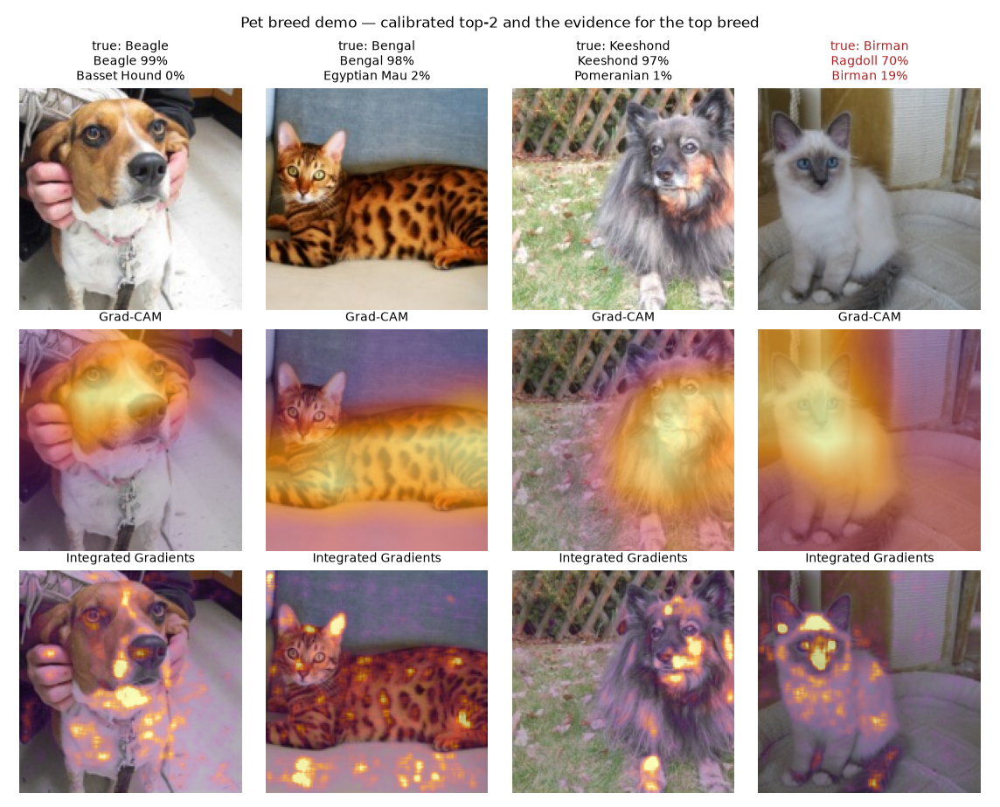
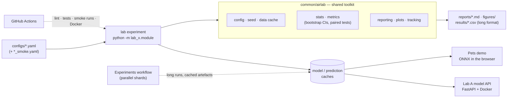

# ai-research-labs

[](https://github.com/ISch-1/ai-research-labs/actions/workflows/ci.yml)
[](https://www.python.org/)
[](https://github.com/astral-sh/ruff)
[](LICENSE)
[](https://huggingface.co/spaces/Iansha/pet-breeds-gradcam)

> Three reproducible research labs that compare classical ML, statistical methods and neural networks — on tabular data, text and images — and answer each question **with confidence intervals and significance tests, not single numbers**. Every experiment is a config file plus one command; every model that matters ships behind an API or a demo.

---

## Headline results

| Lab | Question | Answer (95% CI or test) | Report |
|---|---|---|---|
| A1 | Does boosting beat linear models on tabular data? | On 48k rows yes (ROC-AUC 0.927 [0.922, 0.932] vs. 0.905); on 569 rows **no model is significantly better** | [A](docs/reports/lab-a-predictive.md#31-tabular-prediction-a1) |
| A2 | Do ML/neural forecasters beat classical statistics? | ETS and SARIMA share the best rank over 6 series (Friedman p = 0.001); the MLP loses to seasonal naive on short series | [A](docs/reports/lab-a-predictive.md#32-forecasting-a2) |
| A3 | Is a published customer segmentation real? | Reproduced exactly (silhouette 0.548) but unstable: bootstrap ARI 0.73 [0.35, 1.00]; a log-scale K = 2 solution reaches 0.96 | [A](docs/reports/lab-a-predictive.md#33-clustering-a3a) |
| A4 | Does any model win in general (12 datasets)? | Random Forest, LightGBM and logistic regression are statistically tied (Holm p = 0.18) | [A](docs/reports/lab-a-predictive.md#35-across-datasets-a4) |
| B1 | Do sentence embeddings beat TF-IDF? | On topics and sentiment; on emotions bag-of-words wins by 16 points (Friedman p = 0.54) | [B](docs/reports/lab-b-nlp-llm.md#31-representations-b1) |
| B2 | Prompt an LLM or label data? | 128 labels beat a 1.5B LLM on topics; few-shot prompting wins on sentiment (94.0%) | [B](docs/reports/lab-b-nlp-llm.md#32-trained-models-vs-prompting-b2) |
| B3 | Which retriever? | Hybrid + cross-encoder nDCG@10 0.929 on SQuAD at ~100× the latency; the re-ranker does not transfer to SciFact | [B](docs/reports/lab-b-nlp-llm.md#33-search-b3) |
| B4 | Is a small RAG system trustworthy? | Retrieval lifts F1 0.10 → 0.61, but it hallucinates 95% of unanswerable questions and one poisoned passage hijacks 60–95% of answers | [B](docs/reports/lab-b-nlp-llm.md#34-retrieval-augmented-generation-b4) |
| C2 | Why did fine-tuning lose to a frozen backbone? | BatchNorm statistics drift; freezing them gives the best Pets model, **90.5% [89.6, 91.4]** | [C](docs/reports/lab-c-vision.md#32-inductive-bias-and-transfer-learning-c2) |
| C4 | Are its probabilities trustworthy? | Under-confident; temperature scaling cuts the calibration error from 0.150 to 0.015 | [C](docs/reports/lab-c-vision.md#34-errors-calibration-and-robustness-c4) |
| C5 | Are attribution maps faithful? | Integrated Gradients yes (p < 0.0001); Grad-CAM, the most convincing, no better than random (p = 0.33) | [C](docs/reports/lab-c-vision.md#35-faithfulness-of-attribution-maps-and-shortcut-learning-c5) |

## Labs

| Lab | Questions it answers | Code & detailed reports | Technical report |
|---|---|---|---|
| **A — Predictive & Statistical Modeling** | Do complex models really beat linear ones on tabular data? Classical vs. ML vs. neural forecasting? Which anomaly detector, and how stable are the clusters? Served via a typed FastAPI + Docker service. | [lab-a-predictive/](lab-a-predictive/) | [Lab A](docs/reports/lab-a-predictive.md) |
| **B — NLP & LLM Research** | TF-IDF vs. embeddings vs. fine-tuning vs. prompting. How good is a RAG system, really — does it abstain, can it be poisoned, and at what cost and latency? Runs on a laptop CPU or on GitHub Actions. | [lab-b-nlp-llm/](lab-b-nlp-llm/) | [Lab B](docs/reports/lab-b-nlp-llm.md) |
| **C — Computer Vision Research** | From a NumPy perceptron to transfer learning: what do augmentation and pre-training buy, why can fine-tuning lose to a frozen backbone, and is an attribution map faithful to what the model uses? | [lab-c-vision/](lab-c-vision/) | [Lab C](docs/reports/lab-c-vision.md) |

## Demo — pet breeds with attribution maps

**[Try it live on Hugging Face Spaces](https://huggingface.co/spaces/Iansha/pet-breeds-gradcam)** — the best Lab C model, exported to ONNX and
running [in the visitor's browser](demos/pets-web/): 37 breeds, calibrated probabilities and a
class-activation map, with no server. A [Gradio version](demos/pets-gradcam/) for local use adds
Integrated Gradients, the attribution method that passed Lab C's faithfulness test. Below, its
output on four test images; the fourth is a known failure — a birman taken for a ragdoll, the
most-confused pair.



To run them locally:

```bash
python -m lab_c.export --config lab-c-vision/configs/export_demo.yaml   # weights from the C2 cache
pip install gradio && python demos/pets-gradcam/app.py                   # Gradio, http://127.0.0.1:7860
pip install -e ".[demo]" && python demos/pets-web/export_onnx.py         # ONNX + static page
python -m http.server 8000 --directory demos/pets-web                   # http://localhost:8000
```

---

## Architecture



Every experiment follows the same protocol:

```
typed config ──> set_seed() ──> repeated CV / backtest / fixed splits
             ──> held-out test set, touched once ──> metrics with 95% bootstrap CIs
             ──> paired tests (corrected t, McNemar, Wilcoxon, Diebold-Mariano) + Holm
             ──> Friedman + Nemenyi across datasets ──> Markdown report + long-format CSV
```

The shared toolkit lives in [`common/airlab`](common/airlab):

| Module | Purpose |
|---|---|
| [`stats.py`](common/airlab/stats.py) | Nadeau-Bengio corrected t-test, Wilcoxon, McNemar, Friedman + Nemenyi critical difference, Holm correction, Diebold-Mariano |
| [`metrics.py`](common/airlab/metrics.py) | Metric reports with percentile bootstrap confidence intervals |
| [`experiment.py`](common/airlab/experiment.py) | `python -m … --config … --set key=value` entry points, output folders, host description |
| [`reporting.py`](common/airlab/reporting.py) | Markdown tables and the long-format results files every experiment writes |
| [`plots.py`](common/airlab/plots.py) | Critical-difference diagrams and shared figure helpers |
| [`config.py`](common/airlab/config.py) | YAML → pydantic configs that reject typos; nested overrides |
| [`tracking.py`](common/airlab/tracking.py) | MLflow tracking with a zero-dependency JSON fallback |
| [`data.py`](common/airlab/data.py) | Dataset download cache with SHA-256 verification |
| [`seed.py`](common/airlab/seed.py) | One call seeds Python, NumPy and PyTorch |

---

## Quickstart

Prerequisites: Python 3.11+. Docker is optional (model API container, MLflow UI).

```bash
git clone https://github.com/ISch-1/ai-research-labs.git && cd ai-research-labs
pip install -e ".[dev,lab-a]"
python -m lab_a.baseline --config lab-a-predictive/configs/baseline.yaml
```

That prints a report like [`baseline_breast_cancer.md`](lab-a-predictive/reports/baseline_breast_cancer.md)
and logs the run to `./mlruns` (`mlflow ui` or `docker compose up -d mlflow` to browse runs).
Labs B and C need PyTorch: on CPU-only machines install it first with
`pip install torch torchvision --index-url https://download.pytorch.org/whl/cpu`, then
`pip install -e ".[dev,lab-b,lab-c]"`. Each lab README lists its commands; long experiments can
run on GitHub Actions instead (`gh workflow run experiments.yml -f experiment=c3_augmentation`).

With `make` available: `make setup`, `make test`, `make lab-a` (all experiments), `make export && make serve` (API), `make docker`.

## Documentation

| | |
|---|---|
| Technical reports | [Lab A](docs/reports/lab-a-predictive.md) · [Lab B](docs/reports/lab-b-nlp-llm.md) · [Lab C](docs/reports/lab-c-vision.md) — question, method, results with CIs, limitations |
| Model cards | [Lab A API models](docs/model-cards/lab-a-api-models.md) · [RAG system](docs/model-cards/lab-b-rag-system.md) · [Pets classifier](docs/model-cards/pets-efficientnet-b0.md) |
| Data cards | [All datasets](docs/data-cards.md) — sources, licenses, sensitive attributes, known issues |
| Conventions | [Evaluation and statistics conventions](docs/conventions.md) |

## Engineering standards

- **Reproducible:** fixed seeds, versioned configs, data downloaded by code (never committed), trained models cached by configuration so runs resume.
- **Honest evaluation:** test set touched once; all comparisons reported with CIs and the appropriate paired test — see [docs/conventions.md](docs/conventions.md).
- **Quality gates:** ruff, mypy and pytest on every push (CI matrix 3.11–3.13), every experiment's offline smoke config, and a Docker build that starts the API and calls it; pre-commit strips notebook outputs and blocks secrets.
- **CPU-first:** everything runs on a laptop; long experiments are split into parallel GitHub Actions jobs whose cached artefacts rebuild the full report.

## Related work

- [db-sentinel](https://github.com/ISch-1/db-sentinel) — Isolation Forest anomaly detection running in production on database metrics (the applied counterpart of Lab A's anomaly study).

## Roadmap

- [x] **Phase 0** — repo, shared toolkit, CI, end-to-end baseline
- [x] **Phase 1** — Lab A: regression/classification, forecasting, clustering & anomalies, statistical comparison, model-serving API
- [x] **Phase 2** — Lab B: representations, text classification, semantic search & RAG, LLM evaluation, cost/latency/quality
- [x] **Phase 3** — Lab C: perceptron & MLP from scratch, CNNs & transfer learning, augmentation, error analysis, interpretability
- [x] **Phase 4** — technical reports, model and data cards, [in-browser demo](https://huggingface.co/spaces/Iansha/pet-breeds-gradcam)

## License

[MIT](LICENSE)
