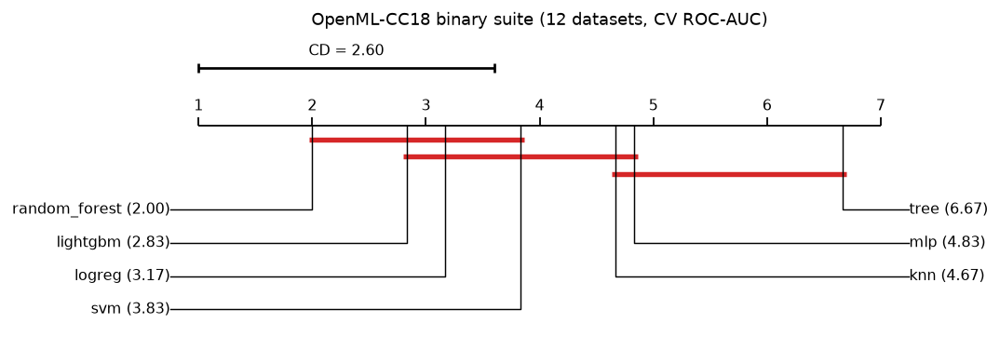

# Lab A — Predictive & Statistical Modeling

> Statistical models, classical machine learning and neural networks compared on tabular data,
> time series, clustering and anomaly detection — every comparison backed by a significance test —
> and the winners served behind a typed FastAPI service in Docker.

## Key findings

**A1 — Tabular data: boosting wins on large data, linear models hold their own on small data.**
- On `adult` (48k rows) LightGBM beats every other model with a significant corrected t-test
  (CV ROC-AUC 0.922 vs. 0.904 for logistic regression); Optuna tuning adds a further, significant
  gain on the test set (ROC-AUC 0.925 → 0.927, McNemar p = 0.001).
- On `breast_cancer` (569 rows) logistic regression is nominally first and **no model is
  significantly better than any other** — a single leaderboard would have hidden that.
- In regression, LightGBM dominates `california_housing` (test RMSE 0.451 → 0.430 tuned, R² 0.86
  vs. 0.58 for OLS), while on `diabetes` plain linear models are statistically tied with the best.
- The MLP never ranks first on any of the 6 datasets with default settings; gradient boosting or
  a linear model is always at least as good.

**A2 — Forecasting: classical statistics beat ML on short seasonal series.**
- ETS and SARIMA share the best average rank (2.0) over 6 series; Friedman p = 0.001.
- ML and neural models only win on the long, smooth CO₂ series (503 points: MLP first, LightGBM
  second); on short series (84–144 points) the MLP is worse than even the seasonal naive
  baseline (MASE up to 7.5).
- On UK driver deaths the **seasonal naive** forecast wins: the 1983 seat-belt law breaks the
  series, and every model that extrapolates the trend pays for it.

**A3a — Clustering: the original K=3 segmentation is real but unstable.**
- K-Means on standardized raw spend reproduces the original study exactly (K = 3,
  silhouette 0.548) but its bootstrap stability is only ARI 0.73 [0.35, 1.00] and it barely
  matches the known Horeca/Retail channel (ARI 0.23).
- Log-transforming the skewed spend gives a K = 2 solution that is far more stable
  (ARI 0.96 [0.83, 1.00]) and recovers the channel (ARI 0.51; 244/252 of one cluster is Horeca).
- The highest silhouette (Ward, 0.79) is the least stable solution (ARI 0.29): silhouette alone
  is a poor model-selection criterion here.

**A3b — Anomaly detection: no universal winner; simple statistics are hard to beat.**
- A robust z-score (median/MAD) is best on both KDD subsets (PR-AUC 0.99 and 0.76), where
  attacks are extreme values of a few features.
- Isolation Forest has the best average rank — never the worst, rarely the best.
- LOF fails on KDD (PR-AUC 0.07–0.10): attacks form dense clusters, which is exactly what a
  local-density method treats as normal. The autoencoder is highly seed-dependent (± 0.24).

**A4 — Across 12 datasets, the top three are statistically indistinguishable.**
- Friedman p < 0.0001: the 7 classifiers do not all perform the same. Random Forest has the best
  average rank (2.00), but **LightGBM (2.83) and logistic regression (3.17) are not significantly
  worse** (Wilcoxon-Holm p = 0.18 for both) — the "boosting always wins" folklore does not survive
  a proper test on default hyper-parameters.
- Random Forest is significantly better than SVM, k-NN, the MLP and a single tree (Holm-adjusted
  p between 0.003 and 0.010).
  Nemenyi is more conservative and still groups SVM with the leaders: the CD diagram and the
  Wilcoxon-Holm table answer slightly different questions, and both are reported.
- With 3–6 datasets (A1, A2, A3b) no post-hoc difference reaches significance; A2's Friedman test
  does (p = 0.001), A3b's does not (p = 0.42). Small benchmarks rarely support "X beats Y in general".



## Modules

| Module | Question | Code | Report |
|---|---|---|---|
| A0 | Does the toolkit work end to end? | [`baseline.py`](src/lab_a/baseline.py) | [baseline](reports/baseline_breast_cancer.md) |
| A1 | Linear/statistical vs. trees/boosting vs. MLP on tabular data — and does tuning matter? | [`supervised.py`](src/lab_a/supervised.py) | [classification](reports/a1_classification.md) · [regression](reports/a1_regression.md) |
| A2 | Baselines vs. ETS/SARIMA vs. LightGBM vs. MLP for forecasting | [`forecasting.py`](src/lab_a/forecasting.py) | [forecasting](reports/a2_forecasting.md) |
| A3a | Are customer segments real (stable, externally valid)? | [`clustering.py`](src/lab_a/clustering.py) | [clustering](reports/a3_clustering.md) |
| A3b | Statistical vs. ML vs. neural anomaly detectors without labels | [`anomaly.py`](src/lab_a/anomaly.py) | [anomalies](reports/a3_anomaly.md) |
| A4 | Does any model win *in general*? (Friedman, Nemenyi, Wilcoxon-Holm over many datasets) | [`benchmark.py`](src/lab_a/benchmark.py) | [benchmark](reports/a4_benchmark.md) |
| A5 | Serving: typed REST API, model metadata, Docker | [`serving/`](src/lab_a/serving/) | [API below](#a5--model-api) |

## Methodology

**A1 — supervised.** Stratified 80/20 split; the test set is touched once. Models are compared with
2×5-fold CV on the training split using default hyper-parameters (so no model gets an unfair tuning
budget) and the Nadeau-Bengio corrected t-test. Selected models are then tuned with Optuna (TPE,
inner 3-fold CV on the training split only) and evaluated on the test set with 95% bootstrap CIs,
McNemar (classification) or Wilcoxon on absolute errors (regression). Diagnostics: calibration
curves, permutation importance, SHAP, and a classical OLS/Logit with CIs and p-values after removing
redundant features (|r| > 0.9 and exact linear dependencies via pivoted QR) and pooling categories
under 1%.

**A2 — forecasting.** Rolling-origin backtesting with 4 origins on 6 public series (monthly and
quarterly). Log transform when the seasonal spread grows with the level; SARIMA orders by AIC with
`d` from KPSS; ETS chosen by AIC among 6 state-space specifications; LightGBM/MLP forecast the first
differences recursively from seasonal lags. Metrics: MASE (headline), sMAPE, MAE, RMSE and
prediction-interval coverage; Diebold-Mariano (HLN correction) against the best model per series;
Friedman across series. Each series gets ADF/KPSS tests and an STL decomposition.

**A3a — clustering.** K-Means, GMM, Ward, DBSCAN (eps from the k-distance knee) and HDBSCAN on raw
vs. log-transformed standardized spend; k by silhouette (plus GMM BIC). Solutions are judged by
**bootstrap stability** (ARI between the full fit and 100 refits on 80% subsamples) and agreement
with a known external label, not only by internal indices. A synthetic dataset with planted
clusters validates the procedure first.

**A3b — anomalies.** Unsupervised detectors fitted on contaminated data; labels only for scoring.
PR-AUC (with bootstrap CI) is the headline metric because anomalies are rare; ROC-AUC and
precision@n are also reported. Randomized detectors are repeated over 5 seeds.

**A4 — across datasets.** 7 classifiers × 12 binary OpenML-CC18 datasets, then the same
rank-based analysis applied to A1, A2 and A3b results: Friedman test, Nemenyi critical difference
(CD diagram) and Wilcoxon signed-rank against the best model with Holm correction.

## Run

```bash
pip install -e ".[dev,lab-a]"

python -m lab_a.supervised  --config lab-a-predictive/configs/a1_classification.yaml
python -m lab_a.supervised  --config lab-a-predictive/configs/a1_regression.yaml
python -m lab_a.forecasting --config lab-a-predictive/configs/a2_forecasting.yaml
python -m lab_a.clustering  --config lab-a-predictive/configs/a3_clustering.yaml
python -m lab_a.anomaly     --config lab-a-predictive/configs/a3_anomaly.yaml
python -m lab_a.benchmark   --config lab-a-predictive/configs/a4_benchmark.yaml   # last: reads the others
```

Datasets are downloaded once into `./data` (OpenML, UCI, Rdatasets; checksums pinned where the
source is a plain file). Every config has an offline `*_smoke.yaml` twin that runs in seconds and
is executed in CI. Reports, figures and fold-level results (`reports/results/*.csv`, one row per
dataset × model × fold × metric) are regenerated by the commands above.

## A5 — Model API

```bash
python -m lab_a.serving.export --config lab-a-predictive/configs/a5_export.yaml   # -> ./models
uvicorn lab_a.serving.api:app --port 8000                                         # -> /docs
# or, fully containerised (the image build trains the models):
docker compose up --build lab-a-api
```

| Method | Path | Purpose |
|---|---|---|
| GET | `/health` | Liveness and number of loaded models |
| GET | `/models` | Served models |
| GET | `/models/{name}` | Metadata: input schema, hold-out metrics, versions, git commit |
| POST | `/predict/{name}` | Tabular regression / classification (validated per model) |
| POST | `/forecast/{name}` | Point forecast + prediction interval for `horizon` steps |
| POST | `/anomaly/{name}` | Anomaly score and flag (threshold set at export) |

Served models: `adult_income` (LightGBM classifier), `california_housing` (LightGBM regressor),
`air_passengers` (ETS), `kdd_http` (Isolation Forest). Request bodies are validated against a
pydantic model generated from each model's own feature schema (types, allowed categories, unknown
fields rejected); every response carries an `X-Process-Time-Ms` header.

> A real example of why model metadata and inspection matter: `adult_income` assigns a 10%
> probability to a profile with `capital-gain = 5000` but 89% to the same profile with 0. Not a
> bug — in the data all 117 people with a gain of exactly 5013 earn ≤ 50K, and the trees learned
> a split there. Monotonic constraints or binning would be the production fix.

```bash
curl -X POST localhost:8000/forecast/air_passengers \
     -H 'content-type: application/json' -d '{"horizon": 12, "level": 0.9}'
```

## Layout

```
configs/          YAML experiment configs (+ *_smoke.yaml for CI)
src/lab_a/        experiments, datasets, model zoo
src/lab_a/serving export + FastAPI app
reports/          generated reports, figures/ and results/ (committed)
Dockerfile        two-stage image: train & export, then a slim API runtime
```
