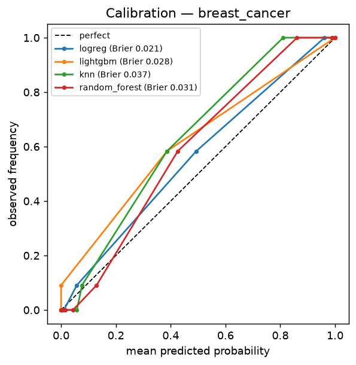
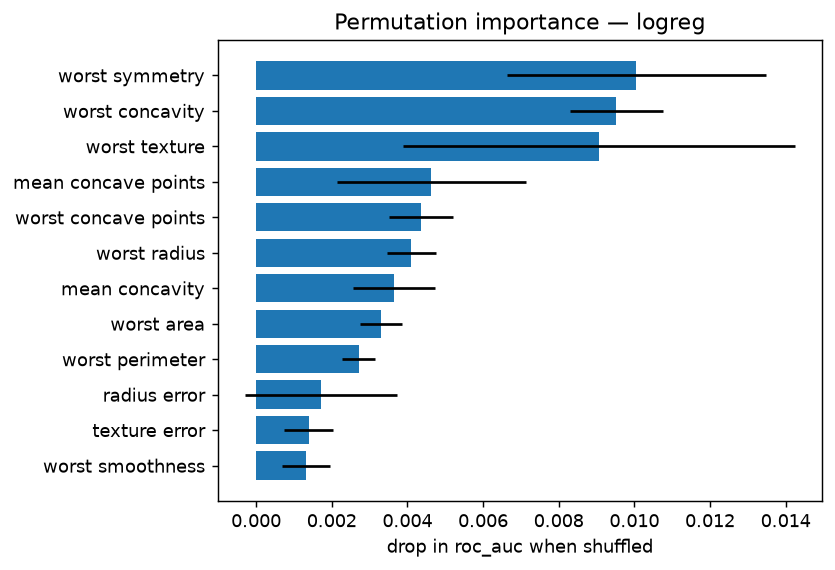
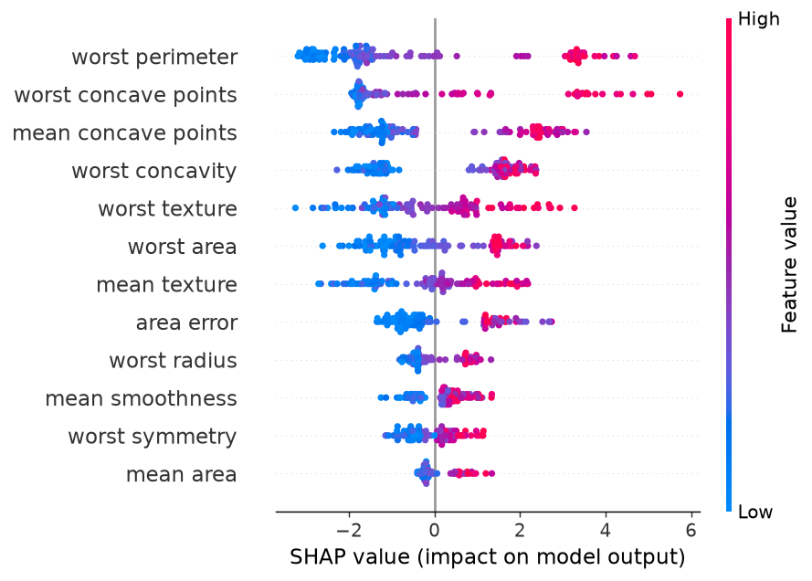
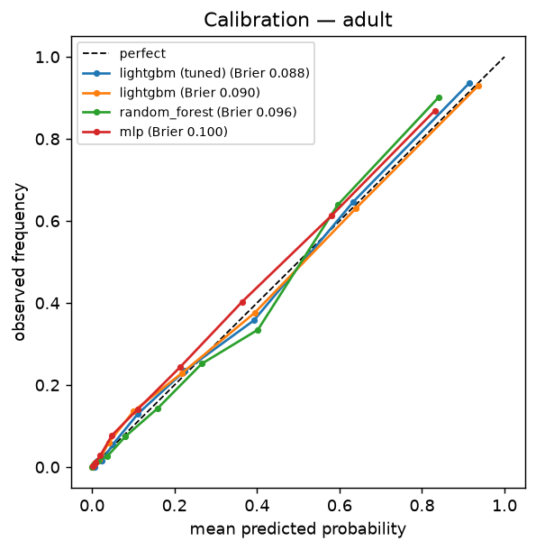
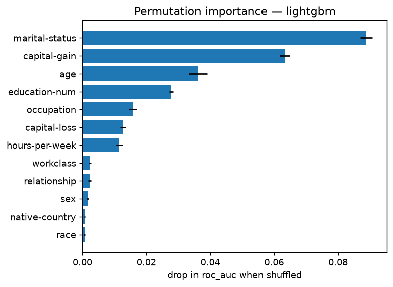
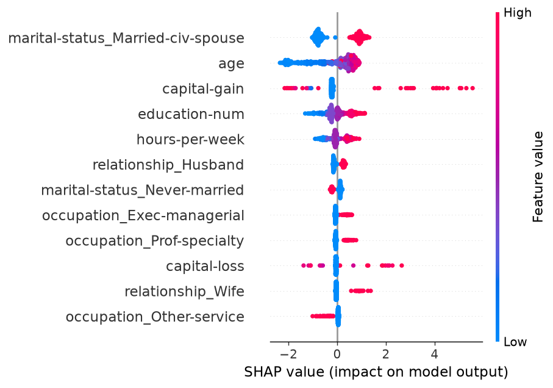
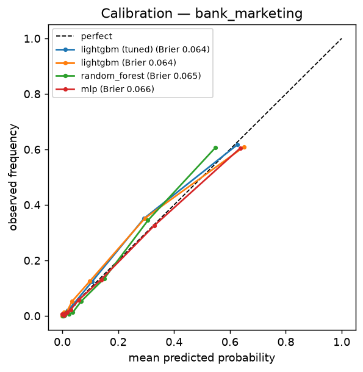
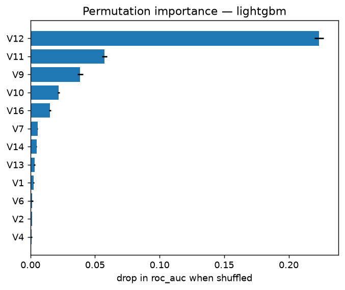
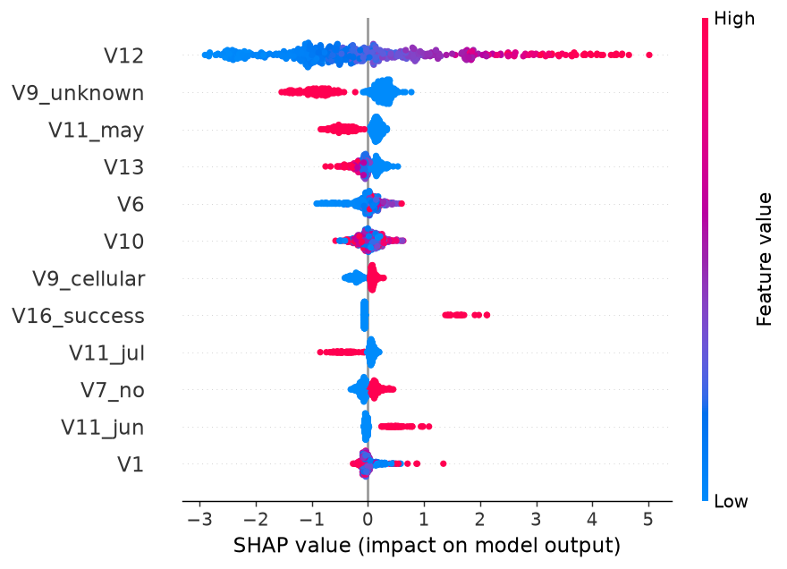

# A1 — Classification: statistical vs. classical ML vs. neural networks

Seed 42 · CV roc_auc (mean over 2×5 folds) · lower rank is better · fold-level results in [`results/a1_classification.csv`](results/a1_classification.csv)

| Model | Family | adult | bank_marketing | breast_cancer | avg rank |
|---|---|---|---|---|---|
| lightgbm | classical ML | 0.9220 | 0.9256 | 0.9934 | 1.33 |
| random_forest | classical ML | 0.9135 | 0.9242 | 0.9889 | 2.67 |
| logreg | statistical | 0.9042 | 0.9063 | 0.9958 | 3.00 |
| mlp | neural network | 0.9083 | 0.9167 | 0.9696 | 3.67 |
| knn | classical ML | 0.8865 | 0.8753 | 0.9892 | 4.67 |
| tree | classical ML | 0.8984 | 0.8197 | 0.9543 | 5.67 |
| dummy | baseline | 0.5000 | 0.5000 | 0.5000 | 7.00 |
| svm | classical ML | — | — | 0.9948 | — (skipped on some datasets) |

## `breast_cancer`

sklearn · 569 rows × 30 features (0 categorical) · train 455 / test 114 · positive rate 37.3%

### Cross-validation (2×5-fold, default hyper-parameters)

| Model | Family | roc_auc | accuracy | f1_macro | brier | fit s | p vs `logreg` |
|---|---|---|---|---|---|---|---|
| **logreg** | statistical | 0.9958 ± 0.0052 | 0.9758 ± 0.0162 | 0.9740 ± 0.0176 | 0.0189 ± 0.0100 | 0.01 | — |
| svm | classical ML | 0.9948 ± 0.0054 | 0.9714 ± 0.0157 | 0.9691 ± 0.0172 | 0.0232 ± 0.0097 | 0.02 | 0.5152 |
| lightgbm | classical ML | 0.9934 ± 0.0054 | 0.9648 ± 0.0154 | 0.9619 ± 0.0172 | 0.0276 ± 0.0126 | 0.16 | 0.0878 |
| knn | classical ML | 0.9892 ± 0.0103 | 0.9582 ± 0.0263 | 0.9539 ± 0.0297 | 0.0341 ± 0.0162 | 0.01 | 0.1345 |
| random_forest | classical ML | 0.9889 ± 0.0089 | 0.9549 ± 0.0291 | 0.9516 ± 0.0310 | 0.0339 ± 0.0135 | 0.44 | 0.1874 |
| mlp | neural network | 0.9696 ± 0.0265 | 0.8989 ± 0.0691 | 0.8839 ± 0.0829 | 0.0880 ± 0.0434 | 0.05 | 0.1045 |
| tree | classical ML | 0.9543 ± 0.0337 | 0.9286 ± 0.0360 | 0.9231 ± 0.0387 | 0.0578 ± 0.0303 | 0.01 | 0.0615 |
| dummy | baseline | 0.5000 ± 0.0000 | 0.6264 ± 0.0000 | 0.3851 ± 0.0000 | 0.2340 ± 0.0000 | 0.01 | < 0.0001 |

Corrected t-test on roc_auc: `logreg` is not significantly better than `svm`, `lightgbm`, `knn`, `random_forest`, `mlp`, `tree` (α = 0.05).

### Tuned hyper-parameters (Optuna, inner CV on the training split)

- **logreg** (30 trials): C=1.363
- **lightgbm** (30 trials): n_estimators=400, learning_rate=0.08424, num_leaves=46, min_child_samples=14, subsample=0.5215, subsample_freq=1, colsample_bytree=0.7612, reg_lambda=0.008749

### Test set (114 rows, 95% bootstrap CI)

| Model | accuracy | balanced_accuracy | f1_macro | roc_auc | pr_auc | brier |
|---|---|---|---|---|---|---|
| **logreg** | 0.9649 [0.9298, 0.9912] | 0.9573 [0.9115, 0.9932] | 0.9619 [0.9188, 0.9909] | 0.9960 [0.9862, 1.0000] | 0.9943 [0.9794, 1.0000] | 0.0213 [0.0067, 0.0423] |
| lightgbm | 0.9649 [0.9298, 0.9912] | 0.9524 [0.9000, 0.9891] | 0.9615 [0.9188, 0.9909] | 0.9960 [0.9868, 1.0000] | 0.9943 [0.9809, 1.0000] | 0.0278 [0.0045, 0.0585] |
| knn | 0.9474 [0.8947, 0.9825] | 0.9335 [0.8750, 0.9800] | 0.9422 [0.8869, 0.9815] | 0.9957 [0.9863, 1.0000] | 0.9930 [0.9772, 1.0000] | 0.0374 [0.0177, 0.0624] |
| random_forest | 0.9737 [0.9474, 1.0000] | 0.9643 [0.9250, 1.0000] | 0.9713 [0.9382, 1.0000] | 0.9954 [0.9863, 1.0000] | 0.9929 [0.9792, 1.0000] | 0.0308 [0.0142, 0.0495] |
| svm | 0.9737 [0.9386, 1.0000] | 0.9643 [0.9189, 1.0000] | 0.9713 [0.9343, 1.0000] | 0.9947 [0.9825, 1.0000] | 0.9927 [0.9755, 1.0000] | 0.0222 [0.0071, 0.0434] |
| logreg (tuned) | 0.9737 [0.9386, 1.0000] | 0.9692 [0.9305, 1.0000] | 0.9716 [0.9349, 1.0000] | 0.9947 [0.9832, 1.0000] | 0.9924 [0.9755, 1.0000] | 0.0230 [0.0063, 0.0462] |
| lightgbm (tuned) | 0.9737 [0.9386, 1.0000] | 0.9643 [0.9189, 1.0000] | 0.9713 [0.9330, 1.0000] | 0.9924 [0.9725, 1.0000] | 0.9916 [0.9694, 1.0000] | 0.0205 [0.0000, 0.0474] |
| mlp | 0.8596 [0.7895, 0.9211] | 0.8145 [0.7307, 0.8810] | 0.8351 [0.7477, 0.9000] | 0.9778 [0.9532, 0.9960] | 0.9558 [0.8957, 0.9930] | 0.1099 [0.0903, 0.1318] |
| tree | 0.9035 [0.8509, 0.9474] | 0.8839 [0.8194, 0.9425] | 0.8935 [0.8323, 0.9453] | 0.9540 [0.9064, 0.9942] | 0.9393 [0.8759, 0.9871] | 0.0614 [0.0300, 0.0974] |
| dummy | 0.6316 [0.5351, 0.7193] | 0.5000 [0.5000, 0.5000] | 0.3871 [0.3486, 0.4184] | 0.5000 [0.5000, 0.5000] | 0.3684 [0.2807, 0.4649] | 0.2327 [0.2105, 0.2571] |

McNemar (exact), best two default models `logreg` vs `lightgbm`: p = 1.0000 (not significant).
Tuned vs default `logreg`: p = 1.0000 (not significant).
Tuned vs default `lightgbm`: p = 1.0000 (not significant).

### Interpretation

Permutation importance of `logreg` on the test set:

SHAP values of `lightgbm` (114 test rows):

Logit (odds ratios per 1 SD): no trustworthy fit (no convergence or quasi-separation). 9 redundant features (|r| > 0.9 or linearly dependent) were dropped first: `mean perimeter`, `mean area`, `mean concave points`, `perimeter error`, `area error`, `worst radius`….

## `adult`

OpenML #1590 · 48,842 rows × 14 features (8 categorical) · train 15,000 / test 9,769 · positive rate 23.9%

### Cross-validation (2×5-fold, default hyper-parameters)

| Model | Family | roc_auc | accuracy | f1_macro | brier | fit s | p vs `lightgbm` |
|---|---|---|---|---|---|---|---|
| **lightgbm** | classical ML | 0.9220 ± 0.0043 | 0.8682 ± 0.0060 | 0.8092 ± 0.0091 | 0.0920 ± 0.0028 | 0.38 | — |
| random_forest | classical ML | 0.9135 ± 0.0034 | 0.8599 ± 0.0056 | 0.7934 ± 0.0085 | 0.0976 ± 0.0018 | 0.99 | < 0.0001 |
| mlp | neural network | 0.9083 ± 0.0034 | 0.8509 ± 0.0022 | 0.7845 ± 0.0068 | 0.1020 ± 0.0017 | 1.06 | < 0.0001 |
| logreg | statistical | 0.9042 ± 0.0041 | 0.8490 ± 0.0042 | 0.7780 ± 0.0060 | 0.1034 ± 0.0024 | 0.20 | < 0.0001 |
| tree | classical ML | 0.8984 ± 0.0062 | 0.8522 ± 0.0042 | 0.7756 ± 0.0090 | 0.1026 ± 0.0024 | 0.16 | < 0.0001 |
| knn | classical ML | 0.8865 ± 0.0054 | 0.8385 ± 0.0051 | 0.7679 ± 0.0078 | 0.1111 ± 0.0032 | 0.11 | < 0.0001 |
| dummy | baseline | 0.5000 ± 0.0000 | 0.7607 ± 0.0001 | 0.4321 ± 0.0000 | 0.1820 ± 0.0001 | 0.10 | < 0.0001 |

Corrected t-test on roc_auc: `lightgbm` is significantly better than every other model (α = 0.05).

### Tuned hyper-parameters (Optuna, inner CV on the training split)

- **logreg** (30 trials): C=1.044
- **lightgbm** (30 trials): n_estimators=300, learning_rate=0.02706, num_leaves=38, min_child_samples=5, subsample=0.8274, subsample_freq=1, colsample_bytree=0.5177, reg_lambda=0.02545

### Test set (9,769 rows, 95% bootstrap CI)

| Model | accuracy | balanced_accuracy | f1_macro | roc_auc | pr_auc | brier |
|---|---|---|---|---|---|---|
| lightgbm (tuned) | 0.8775 [0.8713, 0.8839] | 0.8029 [0.7933, 0.8121] | 0.8210 [0.8118, 0.8298] | 0.9271 [0.9215, 0.9324] | 0.8292 [0.8164, 0.8419] | 0.0881 [0.0844, 0.0914] |
| **lightgbm** | 0.8727 [0.8664, 0.8791] | 0.7965 [0.7864, 0.8060] | 0.8141 [0.8048, 0.8231] | 0.9246 [0.9191, 0.9302] | 0.8216 [0.8081, 0.8353] | 0.0900 [0.0861, 0.0935] |
| random_forest | 0.8694 [0.8628, 0.8758] | 0.7874 [0.7767, 0.7965] | 0.8072 [0.7973, 0.8161] | 0.9132 [0.9073, 0.9190] | 0.7965 [0.7816, 0.8113] | 0.0965 [0.0930, 0.0998] |
| mlp | 0.8573 [0.8503, 0.8640] | 0.7649 [0.7537, 0.7743] | 0.7865 [0.7757, 0.7956] | 0.9099 [0.9037, 0.9160] | 0.7766 [0.7614, 0.7922] | 0.1002 [0.0963, 0.1039] |
| logreg | 0.8537 [0.8468, 0.8608] | 0.7684 [0.7577, 0.7782] | 0.7854 [0.7753, 0.7947] | 0.9045 [0.8982, 0.9107] | 0.7659 [0.7505, 0.7820] | 0.1022 [0.0984, 0.1058] |
| logreg (tuned) | 0.8537 [0.8468, 0.8608] | 0.7684 [0.7577, 0.7782] | 0.7854 [0.7753, 0.7947] | 0.9045 [0.8982, 0.9107] | 0.7659 [0.7506, 0.7820] | 0.1022 [0.0984, 0.1058] |
| tree | 0.8569 [0.8502, 0.8638] | 0.7624 [0.7523, 0.7718] | 0.7849 [0.7747, 0.7943] | 0.8971 [0.8903, 0.9036] | 0.7397 [0.7237, 0.7556] | 0.1026 [0.0989, 0.1062] |
| knn | 0.8405 [0.8324, 0.8473] | 0.7606 [0.7498, 0.7700] | 0.7714 [0.7609, 0.7808] | 0.8850 [0.8773, 0.8921] | 0.7192 [0.6999, 0.7383] | 0.1109 [0.1071, 0.1150] |
| dummy | 0.7607 [0.7520, 0.7695] | 0.5000 [0.5000, 0.5000] | 0.4320 [0.4292, 0.4349] | 0.5000 [0.5000, 0.5000] | 0.2393 [0.2305, 0.2480] | 0.1821 [0.1775, 0.1866] |

McNemar, best two default models `lightgbm` vs `random_forest`: p = 0.1258 (not significant).
Tuned vs default `logreg`: p = 1.0000 (not significant).
Tuned vs default `lightgbm`: p = 0.0010 (significant).

### Interpretation

Permutation importance of `lightgbm` on the test set:

SHAP values of `lightgbm (tuned)` (500 test rows):

Logit (odds ratios per 1 SD), top effects by magnitude.

| Feature | Estimate | 95% CI | p |
|---|---|---|---|
| marital-status_infrequent_sklearn | 57.658 | [12.951, 256.694] | < 0.0001 |
| marital-status_Married-civ-spouse | 14.085 | [6.693, 29.641] | < 0.0001 |
| capital-gain | 10.047 | [8.031, 12.570] | < 0.0001 |
| relationship_Wife | 3.119 | [2.330, 4.175] | < 0.0001 |
| workclass_Self-emp-not-inc | 0.326 | [0.238, 0.445] | < 0.0001 |
| native-country_United-States | 2.506 | [1.347, 4.661] | 0.0037 |
| workclass_State-gov | 0.401 | [0.281, 0.573] | < 0.0001 |
| education_5th-6th | 2.438 | [0.000, 116346.535] | 0.8712 |
| native-country_infrequent_sklearn | 2.395 | [1.240, 4.626] | 0.0093 |
| occupation_Farming-fishing | 0.427 | [0.284, 0.642] | < 0.0001 |

## `bank_marketing`

OpenML #1461 · 45,211 rows × 16 features (9 categorical) · train 15,000 / test 9,043 · positive rate 11.7%

### Cross-validation (2×5-fold, default hyper-parameters)

| Model | Family | roc_auc | accuracy | f1_macro | brier | fit s | p vs `lightgbm` |
|---|---|---|---|---|---|---|---|
| **lightgbm** | classical ML | 0.9256 ± 0.0063 | 0.9021 ± 0.0051 | 0.7317 ± 0.0134 | 0.0665 ± 0.0026 | 0.48 | — |
| random_forest | classical ML | 0.9242 ± 0.0098 | 0.9005 ± 0.0060 | 0.6854 ± 0.0187 | 0.0662 ± 0.0025 | 1.01 | 0.6907 |
| mlp | neural network | 0.9167 ± 0.0084 | 0.9014 ± 0.0054 | 0.7290 ± 0.0157 | 0.0684 ± 0.0031 | 1.20 | 0.0201 |
| logreg | statistical | 0.9063 ± 0.0079 | 0.8998 ± 0.0044 | 0.6930 ± 0.0098 | 0.0716 ± 0.0030 | 0.15 | 0.0001 |
| knn | classical ML | 0.8753 ± 0.0133 | 0.8962 ± 0.0061 | 0.6516 ± 0.0189 | 0.0734 ± 0.0029 | 0.15 | < 0.0001 |
| tree | classical ML | 0.8197 ± 0.0128 | 0.8955 ± 0.0046 | 0.6954 ± 0.0115 | 0.0793 ± 0.0032 | 0.17 | < 0.0001 |
| dummy | baseline | 0.5000 ± 0.0000 | 0.8830 ± 0.0000 | 0.4689 ± 0.0000 | 0.1033 ± 0.0000 | 0.12 | < 0.0001 |

Corrected t-test on roc_auc: `lightgbm` is not significantly better than `random_forest` (α = 0.05).

### Tuned hyper-parameters (Optuna, inner CV on the training split)

- **logreg** (30 trials): C=0.08914
- **lightgbm** (30 trials): n_estimators=400, learning_rate=0.02912, num_leaves=38, min_child_samples=12, subsample=0.9194, subsample_freq=1, colsample_bytree=0.5425, reg_lambda=0.3099

### Test set (9,043 rows, 95% bootstrap CI)

| Model | accuracy | balanced_accuracy | f1_macro | roc_auc | pr_auc | brier |
|---|---|---|---|---|---|---|
| lightgbm (tuned) | 0.9050 [0.8989, 0.9108] | 0.6982 [0.6825, 0.7130] | 0.7303 [0.7143, 0.7449] | 0.9288 [0.9219, 0.9356] | 0.6114 [0.5808, 0.6437] | 0.0638 [0.0605, 0.0674] |
| **lightgbm** | 0.9053 [0.8991, 0.9111] | 0.7086 [0.6918, 0.7231] | 0.7375 [0.7215, 0.7514] | 0.9277 [0.9208, 0.9345] | 0.6066 [0.5764, 0.6387] | 0.0644 [0.0611, 0.0681] |
| random_forest | 0.9037 [0.8980, 0.9094] | 0.6548 [0.6401, 0.6690] | 0.6961 [0.6792, 0.7122] | 0.9259 [0.9187, 0.9325] | 0.6040 [0.5713, 0.6366] | 0.0650 [0.0619, 0.0681] |
| mlp | 0.9059 [0.8995, 0.9116] | 0.7261 [0.7102, 0.7417] | 0.7487 [0.7335, 0.7631] | 0.9153 [0.9072, 0.9231] | 0.5758 [0.5425, 0.6069] | 0.0665 [0.0632, 0.0700] |
| logreg (tuned) | 0.9006 [0.8944, 0.9067] | 0.6530 [0.6389, 0.6668] | 0.6913 [0.6746, 0.7072] | 0.9055 [0.8963, 0.9141] | 0.5390 [0.5088, 0.5727] | 0.0721 [0.0682, 0.0760] |
| logreg | 0.9003 [0.8941, 0.9062] | 0.6586 [0.6441, 0.6729] | 0.6956 [0.6795, 0.7108] | 0.9038 [0.8942, 0.9128] | 0.5413 [0.5112, 0.5749] | 0.0718 [0.0678, 0.0758] |
| knn | 0.8956 [0.8896, 0.9018] | 0.6203 [0.6070, 0.6328] | 0.6560 [0.6396, 0.6713] | 0.8741 [0.8632, 0.8850] | 0.5030 [0.4717, 0.5360] | 0.0749 [0.0711, 0.0789] |
| tree | 0.8991 [0.8927, 0.9050] | 0.6629 [0.6483, 0.6766] | 0.6979 [0.6820, 0.7126] | 0.8194 [0.8033, 0.8346] | 0.4572 [0.4258, 0.4922] | 0.0788 [0.0747, 0.0832] |
| dummy | 0.8830 [0.8766, 0.8893] | 0.5000 [0.5000, 0.5000] | 0.4689 [0.4671, 0.4707] | 0.5000 [0.5000, 0.5000] | 0.1170 [0.1107, 0.1234] | 0.1033 [0.0985, 0.1082] |

McNemar, best two default models `lightgbm` vs `random_forest`: p = 0.4549 (not significant).
Tuned vs default `logreg`: p = 0.7705 (not significant).
Tuned vs default `lightgbm`: p = 0.8894 (not significant).

### Interpretation

Permutation importance of `lightgbm` on the test set:

SHAP values of `lightgbm (tuned)` (500 test rows):

Logit (odds ratios per 1 SD), top effects by magnitude.

| Feature | Estimate | 95% CI | p |
|---|---|---|---|
| V16_success | 10.970 | [8.210, 14.659] | < 0.0001 |
| V9_unknown | 0.209 | [0.163, 0.267] | < 0.0001 |
| V11_jan | 0.222 | [0.141, 0.349] | < 0.0001 |
| V11_mar | 4.428 | [2.937, 6.676] | < 0.0001 |
| V12 | 3.118 | [2.943, 3.303] | < 0.0001 |
| V2_housemaid | 0.353 | [0.213, 0.584] | < 0.0001 |
| V11_oct | 2.763 | [1.936, 3.942] | < 0.0001 |
| V11_sep | 2.528 | [1.684, 3.795] | < 0.0001 |
| V11_nov | 0.415 | [0.310, 0.555] | < 0.0001 |
| V11_infrequent_sklearn | 2.350 | [1.325, 4.170] | 0.0035 |
