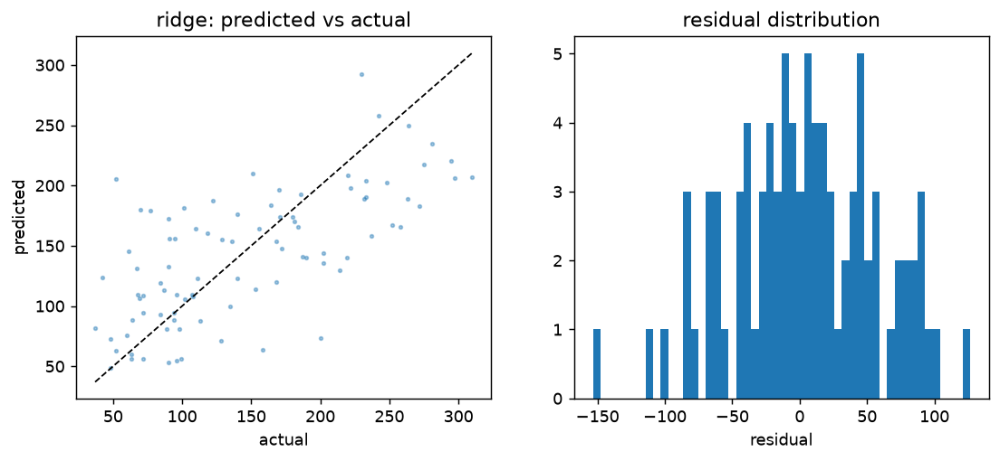
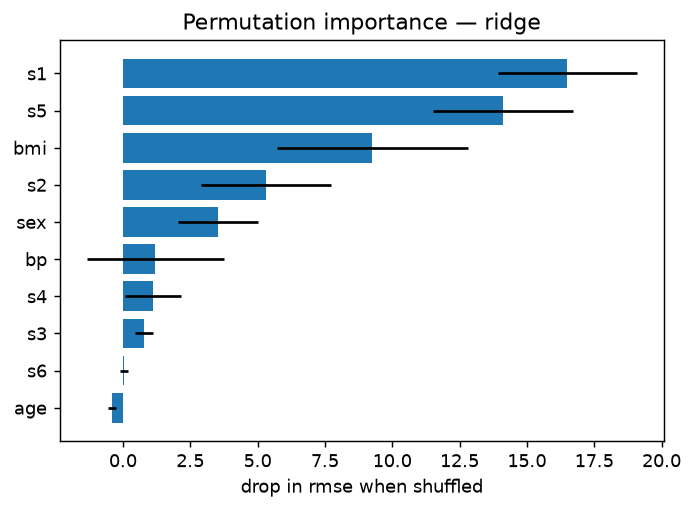
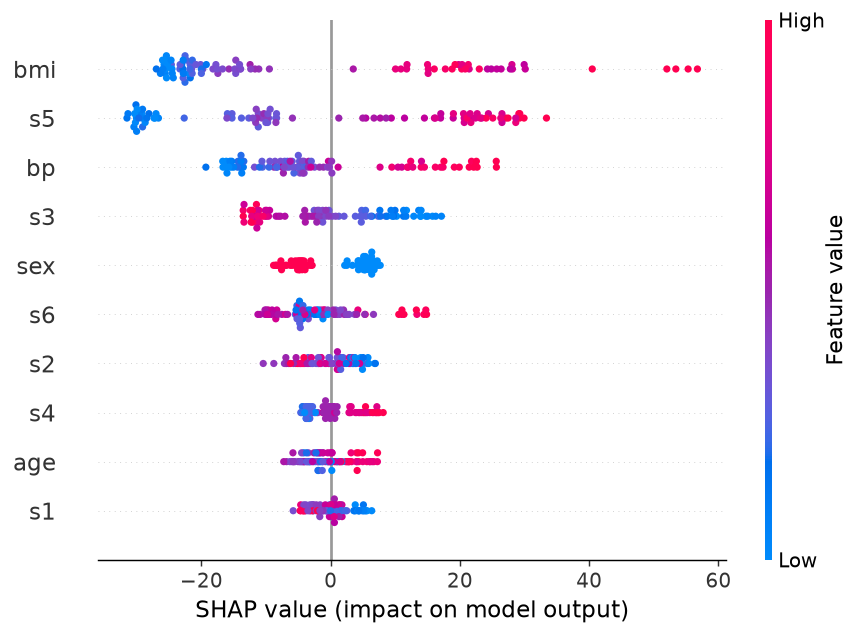
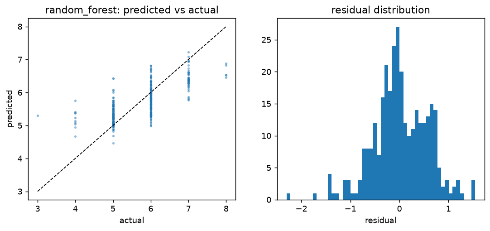
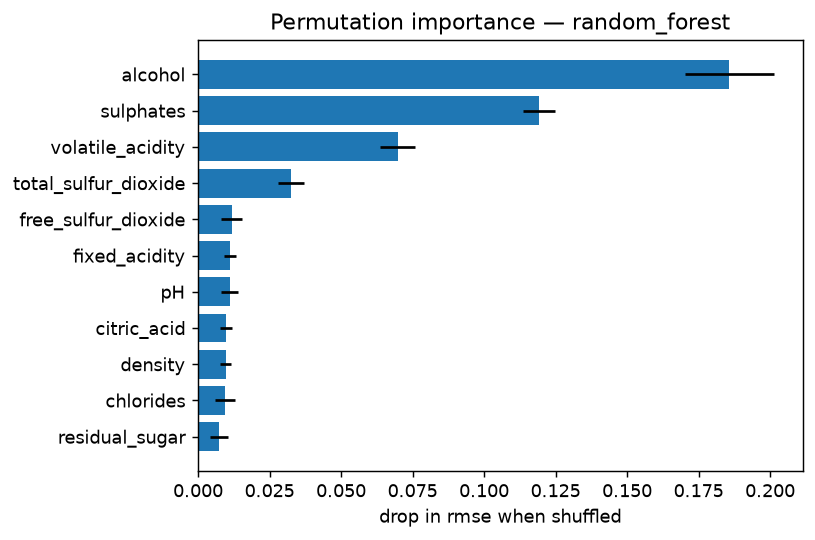
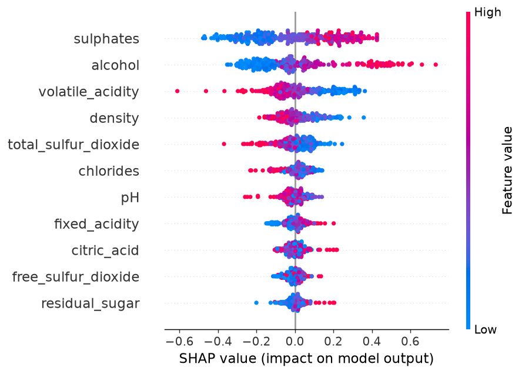
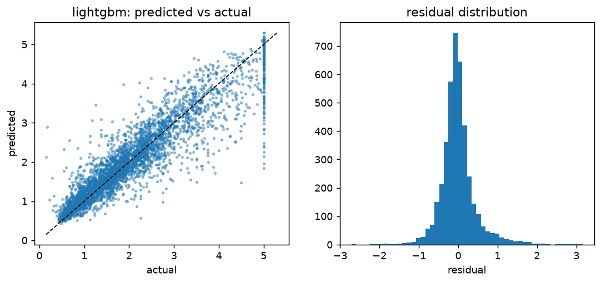
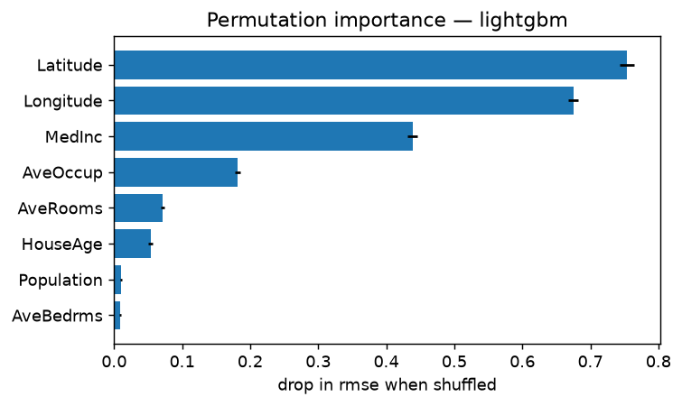
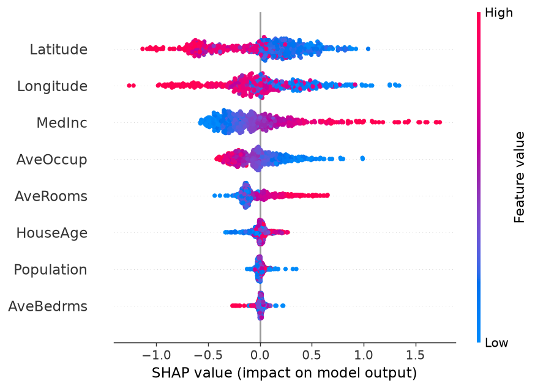

# A1 — Regression: statistical vs. classical ML vs. neural networks

Seed 42 · CV rmse (mean over 2×5 folds) · lower rank is better · fold-level results in [`results/a1_regression.csv`](results/a1_regression.csv)

| Model | Family | california_housing | diabetes | wine_quality_red | avg rank |
|---|---|---|---|---|---|
| random_forest | classical ML | 0.5098 | 58.3657 | 0.5998 | 2.67 |
| lightgbm | classical ML | 0.4588 | 60.8063 | 0.6278 | 3.67 |
| knn | classical ML | 0.6394 | 58.6591 | 0.6214 | 4.00 |
| lasso | statistical | 0.7220 | 55.2272 | 0.6580 | 4.33 |
| mlp | neural network | 0.5346 | 58.2724 | 0.6988 | 4.67 |
| linear | statistical | 0.7186 | 55.2282 | 0.6593 | 4.67 |
| ridge | statistical | 0.7186 | 55.2321 | 0.6593 | 5.00 |
| tree | classical ML | 0.6476 | 71.6325 | 0.7254 | 7.00 |
| dummy | baseline | 1.1530 | 78.1445 | 0.8059 | 9.00 |
| svm | classical ML | — | 72.9747 | 0.6419 | — (skipped on some datasets) |

## `diabetes`

sklearn · 442 rows × 10 features (0 categorical) · train 353 / test 89 · target mean 152

### Cross-validation (2×5-fold, default hyper-parameters)

| Model | Family | rmse | mae | r2 | fit s | p vs `lasso` |
|---|---|---|---|---|---|---|
| **lasso** | statistical | 55.2272 ± 4.3142 | 44.9843 ± 3.4087 | 0.4812 ± 0.0865 | 0.01 | — |
| linear | statistical | 55.2282 ± 4.3212 | 44.9870 ± 3.4164 | 0.4811 ± 0.0867 | 0.01 | 0.9324 |
| ridge | statistical | 55.2321 ± 4.2830 | 44.9695 ± 3.3705 | 0.4812 ± 0.0859 | 0.01 | 0.9477 |
| mlp | neural network | 58.2724 ± 6.0257 | 45.9302 ± 4.5389 | 0.4217 ± 0.1100 | 0.42 | 0.0476 |
| random_forest | classical ML | 58.3657 ± 4.9402 | 48.0486 ± 4.5822 | 0.4190 ± 0.1102 | 0.34 | 0.0058 |
| knn | classical ML | 58.6591 ± 4.8843 | 47.4886 ± 4.4985 | 0.4193 ± 0.0738 | 0.01 | 0.0747 |
| lightgbm | classical ML | 60.8063 ± 4.4799 | 48.8169 ± 3.4809 | 0.3699 ± 0.1153 | 0.04 | 0.0004 |
| tree | classical ML | 71.6325 ± 6.3335 | 57.4787 ± 5.9375 | 0.1193 ± 0.2201 | 0.01 | 0.0005 |
| svm | classical ML | 72.9747 ± 4.9290 | 60.9225 ± 4.7530 | 0.1048 ± 0.0600 | 0.01 | 0.0005 |
| dummy | baseline | 78.1445 ± 4.9946 | 66.7430 ± 5.3755 | -0.0252 ± 0.0232 | 0.01 | 0.0001 |

Corrected t-test on rmse: `lasso` is not significantly better than `linear`, `ridge`, `knn` (α = 0.05).

### Tuned hyper-parameters (Optuna, inner CV on the training split)

- **ridge** (30 trials): alpha=25.79
- **lightgbm** (30 trials): n_estimators=200, learning_rate=0.02092, num_leaves=23, min_child_samples=24, subsample=0.8199, subsample_freq=1, colsample_bytree=0.5413, reg_lambda=1.331

### Test set (89 rows, 95% bootstrap CI)

| Model | rmse | mae | r2 |
|---|---|---|---|
| lightgbm (tuned) | 51.9446 [44.5518, 59.0032] | 42.2062 [36.0527, 48.6240] | 0.4907 [0.2989, 0.6194] |
| ridge (tuned) | 53.5206 [46.4608, 60.9107] | 42.9184 [36.6521, 49.9855] | 0.4593 [0.2817, 0.5877] |
| **ridge** | 53.7775 [46.5503, 61.2363] | 42.8120 [36.4053, 49.9291] | 0.4541 [0.2621, 0.5915] |
| lasso | 53.8365 [46.4840, 61.2487] | 42.7950 [36.3742, 49.9083] | 0.4529 [0.2606, 0.5912] |
| linear | 53.8534 [46.5233, 61.2626] | 42.7941 [36.3634, 49.8920] | 0.4526 [0.2604, 0.5911] |
| random_forest | 54.5052 [47.1839, 62.1853] | 44.2512 [38.2536, 51.2203] | 0.4393 [0.2319, 0.5821] |
| knn | 54.6463 [47.9429, 61.5686] | 44.5765 [38.4537, 51.4219] | 0.4364 [0.2822, 0.5488] |
| lightgbm | 56.9436 [48.5202, 64.6990] | 45.2616 [38.2306, 52.1805] | 0.3880 [0.1469, 0.5587] |
| tree | 59.1093 [50.7651, 67.1299] | 46.6586 [39.7981, 53.9269] | 0.3405 [0.0850, 0.5215] |
| mlp | 59.4753 [51.5748, 67.3686] | 47.5269 [40.5516, 55.3457] | 0.3323 [0.1404, 0.4823] |
| svm | 65.8235 [58.1804, 74.2032] | 56.0295 [49.4495, 63.7974] | 0.1822 [0.0904, 0.2254] |
| dummy | 73.2225 [66.2715, 80.7076] | 64.0065 [56.8092, 71.9173] | -0.0120 [-0.1043, -0.0000] |

Wilcoxon signed-rank on |error|, best two default models `ridge` vs `lasso`: p = 0.7326 (not significant).
Tuned vs default `ridge`: p = 0.7824 (not significant).
Tuned vs default `lightgbm`: p = 0.1982 (not significant).

### Interpretation

Permutation importance of `ridge` on the test set:

SHAP values of `lightgbm (tuned)` (89 test rows):

OLS (coefficients per 1 SD), top effects by magnitude.

| Feature | Estimate | 95% CI | p |
|---|---|---|---|
| s1 | -44.449 | [-86.792, -2.106] | 0.0397 |
| s5 | 35.161 | [17.083, 53.239] | 0.0002 |
| bmi | 25.607 | [18.461, 32.753] | < 0.0001 |
| s2 | 24.641 | [-9.423, 58.705] | 0.1557 |
| bp | 16.829 | [10.036, 23.622] | < 0.0001 |
| s4 | 13.139 | [-4.264, 30.542] | 0.1385 |
| sex | -11.512 | [-17.929, -5.095] | 0.0005 |
| s3 | 7.677 | [-13.854, 29.208] | 0.4836 |
| s6 | 2.351 | [-4.627, 9.330] | 0.5079 |
| age | 1.754 | [-4.531, 8.038] | 0.5834 |

## `wine_quality_red`

OpenML #40691 · 1,599 rows × 11 features (0 categorical) · train 1,279 / test 320 · target mean 5.64

### Cross-validation (2×5-fold, default hyper-parameters)

| Model | Family | rmse | mae | r2 | fit s | p vs `random_forest` |
|---|---|---|---|---|---|---|
| **random_forest** | classical ML | 0.5998 ± 0.0383 | 0.4371 ± 0.0340 | 0.4416 ± 0.0418 | 0.33 | — |
| knn | classical ML | 0.6214 ± 0.0451 | 0.4248 ± 0.0378 | 0.4017 ± 0.0393 | 0.01 | 0.0688 |
| lightgbm | classical ML | 0.6278 ± 0.0378 | 0.4431 ± 0.0350 | 0.3877 ± 0.0503 | 0.12 | 0.0001 |
| svm | classical ML | 0.6419 ± 0.0526 | 0.4664 ± 0.0417 | 0.3622 ± 0.0460 | 0.04 | 0.0065 |
| lasso | statistical | 0.6580 ± 0.0313 | 0.5057 ± 0.0308 | 0.3274 ± 0.0411 | 0.01 | 0.0002 |
| ridge | statistical | 0.6593 ± 0.0317 | 0.5049 ± 0.0316 | 0.3248 ± 0.0417 | 0.01 | 0.0002 |
| linear | statistical | 0.6593 ± 0.0317 | 0.5049 ± 0.0316 | 0.3247 ± 0.0418 | 0.01 | 0.0002 |
| mlp | neural network | 0.6988 ± 0.0418 | 0.5275 ± 0.0304 | 0.2395 ± 0.0820 | 0.65 | 0.0006 |
| tree | classical ML | 0.7254 ± 0.0438 | 0.5265 ± 0.0373 | 0.1815 ± 0.0776 | 0.01 | < 0.0001 |
| dummy | baseline | 0.8059 ± 0.0514 | 0.6843 ± 0.0322 | -0.0055 ± 0.0053 | 0.01 | < 0.0001 |

Corrected t-test on rmse: `random_forest` is not significantly better than `knn` (α = 0.05).

### Tuned hyper-parameters (Optuna, inner CV on the training split)

- **ridge** (30 trials): alpha=95.07
- **lightgbm** (30 trials): n_estimators=600, learning_rate=0.01325, num_leaves=89, min_child_samples=6, subsample=0.7986, subsample_freq=1, colsample_bytree=0.5387, reg_lambda=2.211

### Test set (320 rows, 95% bootstrap CI)

| Model | rmse | mae | r2 |
|---|---|---|---|
| lightgbm (tuned) | 0.5322 [0.4784, 0.5815] | 0.3939 [0.3532, 0.4337] | 0.5667 [0.4971, 0.6265] |
| **random_forest** | 0.5576 [0.5062, 0.6072] | 0.4296 [0.3910, 0.4680] | 0.5243 [0.4506, 0.5834] |
| knn | 0.5669 [0.5073, 0.6240] | 0.4031 [0.3580, 0.4470] | 0.5083 [0.4314, 0.5721] |
| lightgbm | 0.5694 [0.5160, 0.6202] | 0.4225 [0.3802, 0.4658] | 0.5038 [0.4135, 0.5843] |
| svm | 0.5928 [0.5449, 0.6424] | 0.4535 [0.4107, 0.4973] | 0.4623 [0.3786, 0.5247] |
| linear | 0.6245 [0.5766, 0.6727] | 0.5035 [0.4656, 0.5448] | 0.4032 [0.3209, 0.4667] |
| ridge | 0.6245 [0.5766, 0.6727] | 0.5036 [0.4656, 0.5448] | 0.4032 [0.3210, 0.4667] |
| ridge (tuned) | 0.6265 [0.5765, 0.6752] | 0.5068 [0.4684, 0.5495] | 0.3993 [0.3238, 0.4590] |
| lasso | 0.6269 [0.5789, 0.6757] | 0.5077 [0.4686, 0.5495] | 0.3986 [0.3207, 0.4592] |
| mlp | 0.6278 [0.5768, 0.6807] | 0.4941 [0.4514, 0.5382] | 0.3968 [0.2878, 0.4845] |
| tree | 0.6800 [0.6190, 0.7420] | 0.5041 [0.4557, 0.5533] | 0.2924 [0.1714, 0.3986] |
| dummy | 0.8107 [0.7428, 0.8778] | 0.6853 [0.6384, 0.7345] | -0.0056 [-0.0315, -0.0000] |

Wilcoxon signed-rank on |error|, best two default models `random_forest` vs `knn`: p = 0.0196 (significant).
Tuned vs default `ridge`: p = 0.0121 (significant).
Tuned vs default `lightgbm`: p = < 0.0001 (significant).

### Interpretation

Permutation importance of `random_forest` on the test set:

SHAP values of `lightgbm (tuned)` (320 test rows):

OLS (coefficients per 1 SD), top effects by magnitude.

| Feature | Estimate | 95% CI | p |
|---|---|---|---|
| alcohol | 0.297 | [0.235, 0.358] | < 0.0001 |
| volatile_acidity | -0.179 | [-0.228, -0.131] | < 0.0001 |
| sulphates | 0.147 | [0.104, 0.190] | < 0.0001 |
| total_sulfur_dioxide | -0.120 | [-0.173, -0.067] | < 0.0001 |
| chlorides | -0.089 | [-0.133, -0.045] | < 0.0001 |
| pH | -0.061 | [-0.126, 0.004] | 0.0674 |
| free_sulfur_dioxide | 0.058 | [0.007, 0.109] | 0.0245 |
| fixed_acidity | 0.040 | [-0.058, 0.137] | 0.4234 |
| citric_acid | -0.028 | [-0.092, 0.037] | 0.4016 |
| density | -0.019 | [-0.107, 0.069] | 0.6688 |

## `california_housing`

StatLib/sklearn · 20,640 rows × 8 features (0 categorical) · train 15,000 / test 4,128 · target mean 2.07

### Cross-validation (2×5-fold, default hyper-parameters)

| Model | Family | rmse | mae | r2 | fit s | p vs `lightgbm` |
|---|---|---|---|---|---|---|
| **lightgbm** | classical ML | 0.4588 ± 0.0154 | 0.3040 ± 0.0066 | 0.8415 ± 0.0082 | 0.35 | — |
| random_forest | classical ML | 0.5098 ± 0.0195 | 0.3340 ± 0.0084 | 0.8044 ± 0.0108 | 1.96 | < 0.0001 |
| mlp | neural network | 0.5346 ± 0.0179 | 0.3638 ± 0.0095 | 0.7849 ± 0.0102 | 2.63 | < 0.0001 |
| knn | classical ML | 0.6394 ± 0.0208 | 0.4425 ± 0.0078 | 0.6923 ± 0.0123 | 0.02 | < 0.0001 |
| tree | classical ML | 0.6476 ± 0.0215 | 0.4462 ± 0.0129 | 0.6844 ± 0.0154 | 0.06 | < 0.0001 |
| linear | statistical | 0.7186 ± 0.0217 | 0.5271 ± 0.0086 | 0.6115 ± 0.0129 | 0.01 | < 0.0001 |
| ridge | statistical | 0.7186 ± 0.0217 | 0.5271 ± 0.0086 | 0.6115 ± 0.0129 | 0.01 | < 0.0001 |
| lasso | statistical | 0.7220 ± 0.0210 | 0.5306 ± 0.0086 | 0.6077 ± 0.0122 | 0.09 | < 0.0001 |
| dummy | baseline | 1.1530 ± 0.0171 | 0.9112 ± 0.0119 | -0.0004 ± 0.0004 | 0.01 | < 0.0001 |

Corrected t-test on rmse: `lightgbm` is significantly better than every other model (α = 0.05).

### Tuned hyper-parameters (Optuna, inner CV on the training split)

- **ridge** (30 trials): alpha=0.0001027
- **lightgbm** (30 trials): n_estimators=800, learning_rate=0.02835, num_leaves=106, min_child_samples=14, subsample=0.9644, subsample_freq=1, colsample_bytree=0.6275, reg_lambda=0.05415

### Test set (4,128 rows, 95% bootstrap CI)

| Model | rmse | mae | r2 |
|---|---|---|---|
| lightgbm (tuned) | 0.4298 [0.4099, 0.4494] | 0.2783 [0.2681, 0.2880] | 0.8590 [0.8460, 0.8723] |
| **lightgbm** | 0.4513 [0.4313, 0.4708] | 0.2989 [0.2885, 0.3092] | 0.8446 [0.8311, 0.8578] |
| random_forest | 0.5055 [0.4827, 0.5266] | 0.3273 [0.3150, 0.3388] | 0.8050 [0.7887, 0.8216] |
| mlp | 0.5351 [0.5121, 0.5575] | 0.3665 [0.3549, 0.3796] | 0.7815 [0.7635, 0.7993] |
| knn | 0.6488 [0.6236, 0.6726] | 0.4401 [0.4258, 0.4542] | 0.6788 [0.6574, 0.7016] |
| tree | 0.6544 [0.6296, 0.6784] | 0.4541 [0.4393, 0.4678] | 0.6732 [0.6485, 0.6974] |
| lasso | 0.7407 [0.7122, 0.7691] | 0.5351 [0.5192, 0.5507] | 0.5814 [0.5498, 0.6077] |
| ridge | 0.7457 [0.7103, 0.7892] | 0.5331 [0.5171, 0.5488] | 0.5756 [0.5251, 0.6110] |
| ridge (tuned) | 0.7458 [0.7103, 0.7892] | 0.5331 [0.5171, 0.5488] | 0.5756 [0.5250, 0.6110] |
| linear | 0.7458 [0.7103, 0.7892] | 0.5331 [0.5171, 0.5488] | 0.5756 [0.5250, 0.6110] |
| dummy | 1.1448 [1.1194, 1.1716] | 0.9053 [0.8840, 0.9261] | -0.0001 [-0.0018, -0.0000] |

Wilcoxon signed-rank on |error|, best two default models `lightgbm` vs `random_forest`: p = < 0.0001 (significant).
Tuned vs default `ridge`: p = 0.0303 (significant).
Tuned vs default `lightgbm`: p = < 0.0001 (significant).

### Interpretation

Permutation importance of `lightgbm` on the test set:

SHAP values of `lightgbm (tuned)` (500 test rows):

OLS (coefficients per 1 SD), top effects by magnitude. 1 redundant features (|r| > 0.9 or linearly dependent) were dropped first: `Longitude`.

| Feature | Estimate | 95% CI | p |
|---|---|---|---|
| MedInc | 1.018 | [0.999, 1.036] | < 0.0001 |
| AveRooms | -0.491 | [-0.525, -0.458] | < 0.0001 |
| AveBedrms | 0.450 | [0.419, 0.481] | < 0.0001 |
| HouseAge | 0.212 | [0.198, 0.225] | < 0.0001 |
| Latitude | -0.065 | [-0.078, -0.052] | < 0.0001 |
| AveOccup | -0.053 | [-0.065, -0.040] | < 0.0001 |
| Population | 0.017 | [0.004, 0.030] | 0.0121 |
