# A2 — Forecasting: baselines vs. statistical vs. ML vs. neural networks

Rolling-origin backtesting · metric MASE (mean over origins; < 1 beats the in-sample seasonal naive) · fold-level results in [`results/a2_forecasting.csv`](results/a2_forecasting.csv)

| Model | Family | air_passengers | co2_mauna_loa | johnson_johnson | nottingham_temperature | uk_driver_deaths | uk_gas | avg rank |
|---|---|---|---|---|---|---|---|---|
| ets | statistical | 0.622 | 0.511 | 1.265 | 0.582 | 1.382 | 1.727 | 2.00 |
| sarima | statistical | 0.642 | 0.468 | 1.453 | 0.612 | 1.251 | 1.654 | 2.00 |
| lightgbm | classical ML | 1.085 | 0.451 | 2.296 | 0.933 | 2.038 | 2.188 | 3.50 |
| seasonal_naive | baseline | 1.254 | 1.383 | 4.034 | 0.837 | 1.163 | 2.329 | 3.83 |
| mlp | neural network | 3.321 | 0.406 | 7.517 | 0.819 | 1.641 | 5.549 | 4.50 |
| drift | baseline | 1.957 | 2.014 | 4.030 | 4.082 | 2.786 | 10.009 | 6.00 |
| naive | baseline | 2.394 | 2.320 | 6.201 | 4.059 | 2.741 | 9.447 | 6.17 |

Friedman test across 6 series: χ² = 22.14, p = 0.0011. Diebold-Mariano p-values per series compare each model with that series' best (HLN correction, horizon h).

## `air_passengers`

Rdatasets `AirPassengers` · 144 observations · season 12 · horizon h = 12 · 4 rolling origins · log transform · SARIMA(1, 0, 1)×(0, 1, 1)

| Series | ADF p (H0: unit root) | KPSS p (H0: stationary) | Stationary? |
|---|---|---|---|
| level | 0.9919 | 0.010 | no |
| first difference | 0.0542 | 0.100 | no |
| seasonal difference (lag 12) | 0.0116 | 0.034 | no |

STL strength — trend 1.00, seasonality 0.96 (0 = none, 1 = dominant).

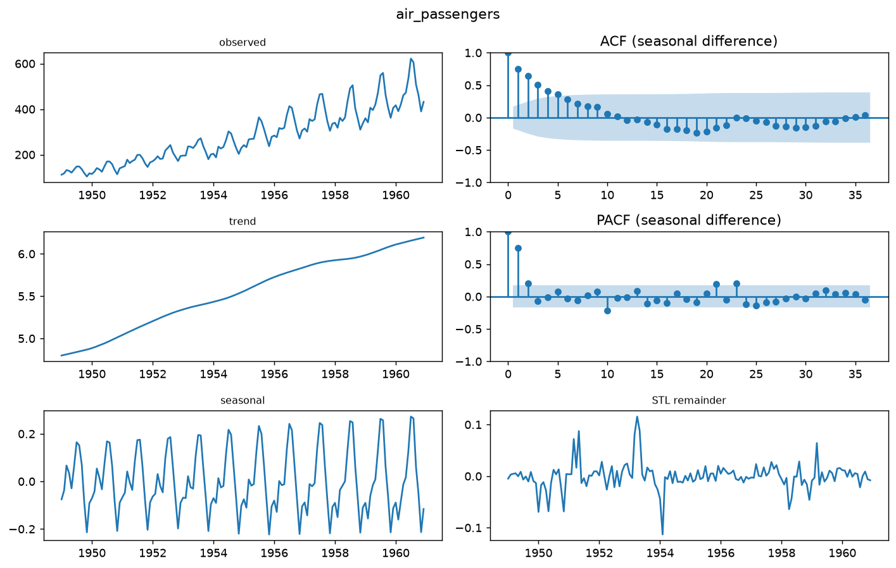

| Model | Family | MASE | sMAPE % | MAE | RMSE | 90% PI coverage | DM p vs `ets` |
|---|---|---|---|---|---|---|---|
| **ets** | statistical | 0.622 | 4.543 | 18.576 | 22.866 | 0.854 | — |
| sarima | statistical | 0.642 | 4.657 | 18.974 | 21.921 | 0.938 | 0.9049 |
| lightgbm | classical ML | 1.085 | 7.017 | 32.484 | 36.223 | — | 0.4319 |
| seasonal_naive | baseline | 1.254 | 9.234 | 36.979 | 39.612 | 0.500 | 0.1193 |
| drift | baseline | 1.957 | 13.893 | 57.898 | 78.601 | 1.000 | 0.0002 |
| naive | baseline | 2.394 | 17.469 | 70.771 | 94.018 | 0.958 | < 0.0001 |
| mlp | neural network | 3.321 | 29.401 | 97.651 | 127.379 | — | 0.0320 |

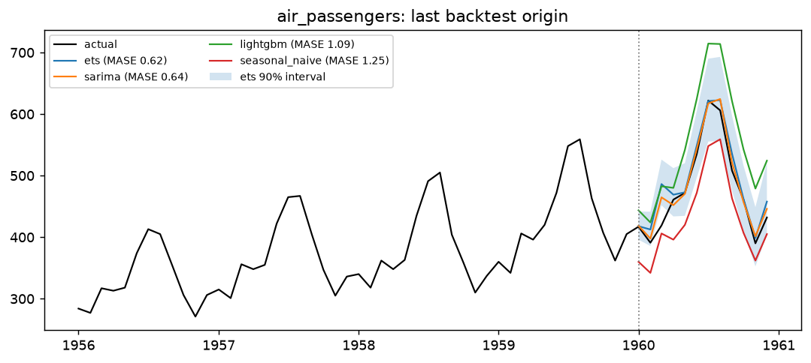

## `uk_driver_deaths`

Rdatasets `UKDriverDeaths` · 192 observations · season 12 · horizon h = 12 · 4 rolling origins · no transform · SARIMA(2, 0, 2)×(0, 1, 1)

| Series | ADF p (H0: unit root) | KPSS p (H0: stationary) | Stationary? |
|---|---|---|---|
| level | 0.7199 | 0.010 | no |
| first difference | < 0.0001 | 0.100 | yes |
| seasonal difference (lag 12) | 0.0097 | 0.100 | yes |

STL strength — trend 0.74, seasonality 0.79 (0 = none, 1 = dominant).

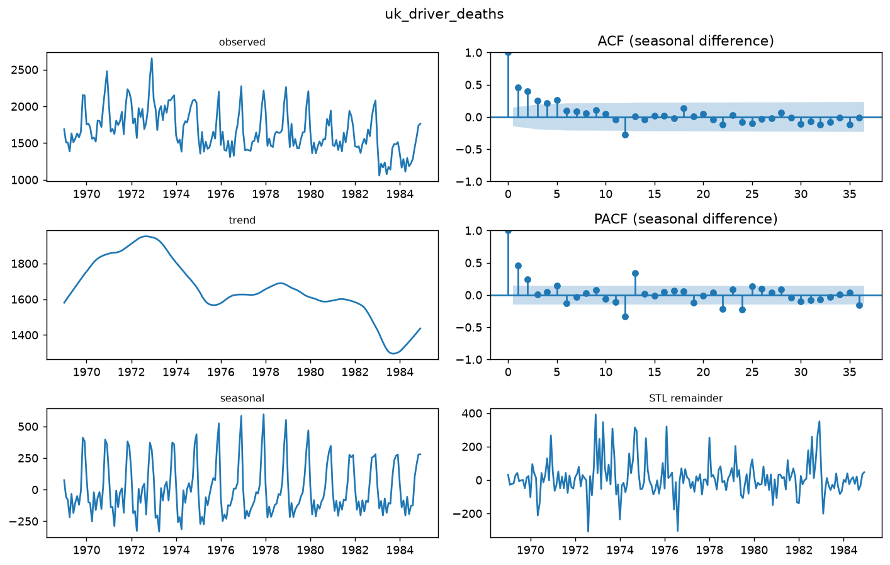

| Model | Family | MASE | sMAPE % | MAE | RMSE | 90% PI coverage | DM p vs `seasonal_naive` |
|---|---|---|---|---|---|---|---|
| **seasonal_naive** | baseline | 1.163 | 11.311 | 169.563 | 195.344 | 0.833 | — |
| sarima | statistical | 1.251 | 12.527 | 182.899 | 201.106 | 0.750 | 0.0077 |
| ets | statistical | 1.382 | 14.183 | 203.204 | 222.483 | 0.771 | 0.1335 |
| mlp | neural network | 1.641 | 16.592 | 239.704 | 274.422 | — | 0.0004 |
| lightgbm | classical ML | 2.038 | 21.196 | 299.828 | 319.884 | — | 0.0187 |
| naive | baseline | 2.741 | 24.479 | 399.500 | 423.326 | 0.854 | 0.0491 |
| drift | baseline | 2.786 | 24.787 | 406.021 | 428.616 | 0.854 | 0.0500 |

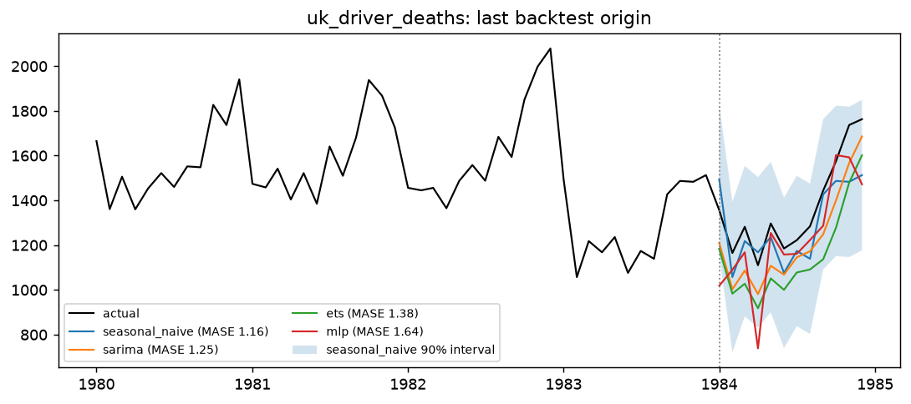

## `nottingham_temperature`

Rdatasets `nottem` · 240 observations · season 12 · horizon h = 12 · 4 rolling origins · no transform · SARIMA(1, 0, 0)×(1, 1, 1)

| Series | ADF p (H0: unit root) | KPSS p (H0: stationary) | Stationary? |
|---|---|---|---|
| level | 0.0177 | 0.100 | yes |
| first difference | < 0.0001 | 0.100 | yes |
| seasonal difference (lag 12) | < 0.0001 | 0.100 | yes |

STL strength — trend 0.15, seasonality 0.95 (0 = none, 1 = dominant).

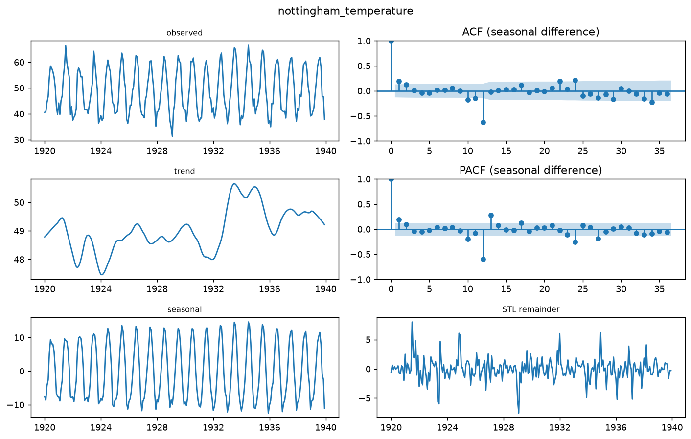

| Model | Family | MASE | sMAPE % | MAE | RMSE | 90% PI coverage | DM p vs `ets` |
|---|---|---|---|---|---|---|---|
| **ets** | statistical | 0.582 | 3.553 | 1.619 | 2.107 | 0.875 | — |
| sarima | statistical | 0.612 | 3.684 | 1.702 | 2.144 | 0.896 | 0.7988 |
| mlp | neural network | 0.819 | 4.804 | 2.279 | 2.878 | — | 0.1538 |
| seasonal_naive | baseline | 0.837 | 5.147 | 2.329 | 3.059 | 0.917 | < 0.0001 |
| lightgbm | classical ML | 0.933 | 5.461 | 2.595 | 3.106 | — | 0.0399 |
| naive | baseline | 4.059 | 24.342 | 11.287 | 13.750 | 0.917 | < 0.0001 |
| drift | baseline | 4.082 | 24.512 | 11.352 | 13.812 | 0.938 | < 0.0001 |

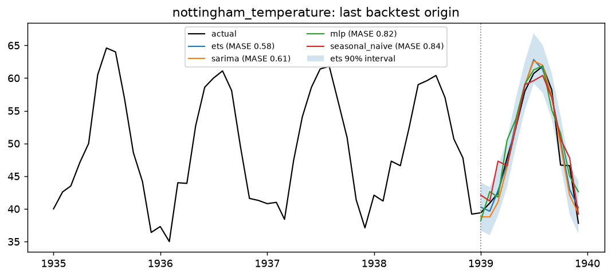

## `co2_mauna_loa`

statsmodels (Mauna Loa) · 503 observations · season 12 · horizon h = 12 · 4 rolling origins · no transform · SARIMA(1, 1, 1)×(0, 1, 1)

| Series | ADF p (H0: unit root) | KPSS p (H0: stationary) | Stationary? |
|---|---|---|---|
| level | 0.9984 | 0.010 | no |
| first difference | 0.0002 | 0.100 | yes |
| seasonal difference (lag 12) | 0.0004 | 0.010 | no |

STL strength — trend 1.00, seasonality 0.99 (0 = none, 1 = dominant).

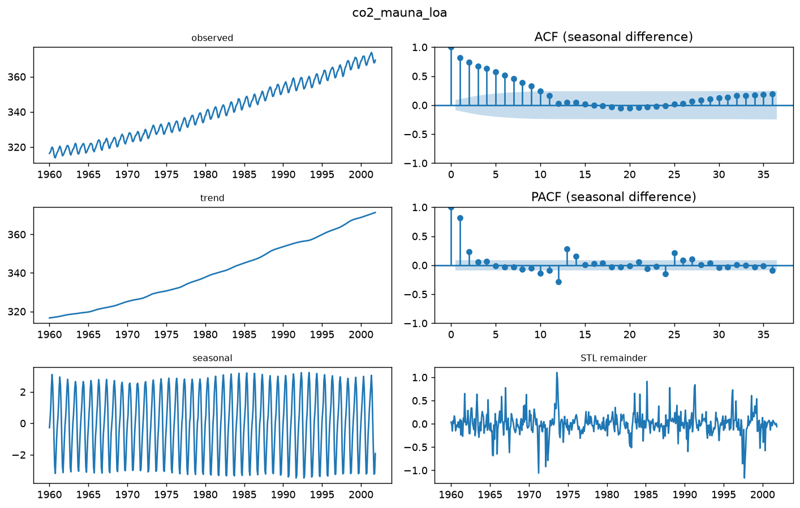

| Model | Family | MASE | sMAPE % | MAE | RMSE | 90% PI coverage | DM p vs `mlp` |
|---|---|---|---|---|---|---|---|
| **mlp** | neural network | 0.406 | 0.142 | 0.522 | 0.584 | — | — |
| lightgbm | classical ML | 0.451 | 0.159 | 0.582 | 0.658 | — | 0.5692 |
| sarima | statistical | 0.468 | 0.165 | 0.605 | 0.692 | 0.708 | 0.7217 |
| ets | statistical | 0.511 | 0.180 | 0.662 | 0.767 | 0.688 | 0.7323 |
| seasonal_naive | baseline | 1.383 | 0.489 | 1.794 | 1.871 | 0.229 | 0.0458 |
| drift | baseline | 2.014 | 0.713 | 2.620 | 3.068 | 0.854 | < 0.0001 |
| naive | baseline | 2.320 | 0.821 | 3.018 | 3.502 | 0.708 | < 0.0001 |

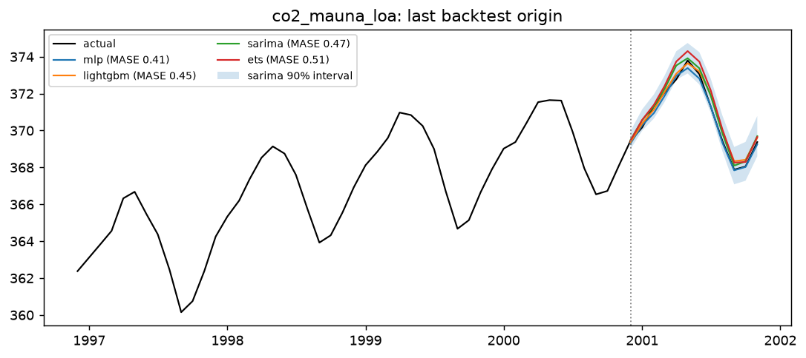

## `uk_gas`

Rdatasets `UKgas` · 108 observations · season 4 · horizon h = 8 · 4 rolling origins · log transform · SARIMA(2, 1, 2)×(0, 1, 0)

| Series | ADF p (H0: unit root) | KPSS p (H0: stationary) | Stationary? |
|---|---|---|---|
| level | 1.0000 | 0.010 | no |
| first difference | < 0.0001 | 0.100 | yes |
| seasonal difference (lag 4) | 0.0777 | 0.010 | no |

STL strength — trend 0.99, seasonality 0.97 (0 = none, 1 = dominant).

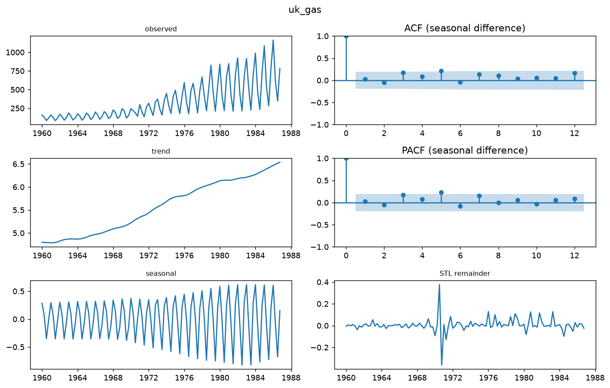

| Model | Family | MASE | sMAPE % | MAE | RMSE | 90% PI coverage | DM p vs `sarima` |
|---|---|---|---|---|---|---|---|
| **sarima** | statistical | 1.654 | 7.854 | 39.865 | 49.254 | 0.969 | — |
| ets | statistical | 1.727 | 8.070 | 41.715 | 49.072 | 0.969 | 0.8408 |
| lightgbm | classical ML | 2.188 | 10.222 | 52.698 | 66.127 | — | 0.2268 |
| seasonal_naive | baseline | 2.329 | 9.777 | 55.831 | 70.001 | 0.875 | 0.1054 |
| mlp | neural network | 5.549 | 20.944 | 136.385 | 168.845 | — | 0.0115 |
| naive | baseline | 9.447 | 41.250 | 229.737 | 272.872 | 1.000 | < 0.0001 |
| drift | baseline | 10.009 | 42.712 | 243.835 | 291.682 | 1.000 | < 0.0001 |

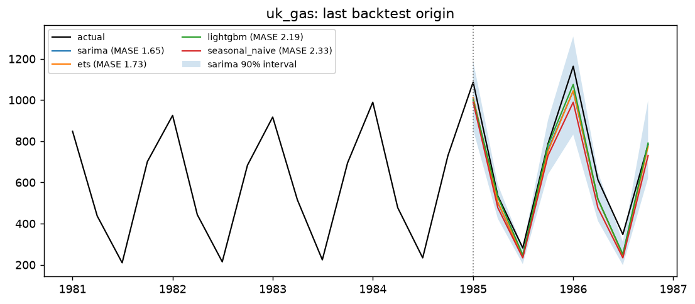

## `johnson_johnson`

Rdatasets `JohnsonJohnson` · 84 observations · season 4 · horizon h = 8 · 4 rolling origins · log transform · SARIMA(1, 0, 1)×(1, 1, 0)

| Series | ADF p (H0: unit root) | KPSS p (H0: stationary) | Stationary? |
|---|---|---|---|
| level | 1.0000 | 0.010 | no |
| first difference | 0.9089 | 0.100 | no |
| seasonal difference (lag 4) | 0.9192 | 0.010 | no |

STL strength — trend 1.00, seasonality 0.84 (0 = none, 1 = dominant).

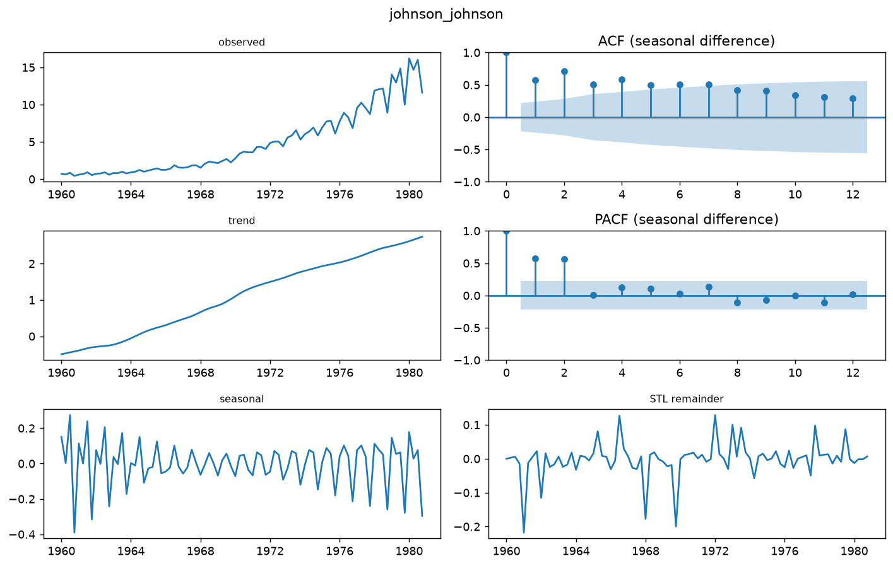

| Model | Family | MASE | sMAPE % | MAE | RMSE | 90% PI coverage | DM p vs `ets` |
|---|---|---|---|---|---|---|---|
| **ets** | statistical | 1.265 | 6.156 | 0.590 | 0.694 | 1.000 | — |
| sarima | statistical | 1.453 | 6.995 | 0.681 | 0.786 | 0.969 | 0.3793 |
| lightgbm | classical ML | 2.296 | 11.412 | 1.030 | 1.242 | — | 0.0259 |
| drift | baseline | 4.030 | 20.792 | 1.947 | 2.211 | 0.969 | 0.1698 |
| seasonal_naive | baseline | 4.034 | 21.508 | 1.865 | 2.028 | 0.438 | 0.0373 |
| naive | baseline | 6.201 | 34.437 | 2.945 | 3.173 | 0.938 | 0.1202 |
| mlp | neural network | 7.517 | 29.156 | 3.453 | 3.951 | — | 0.0684 |

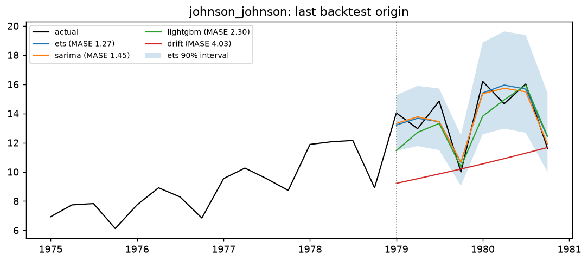
