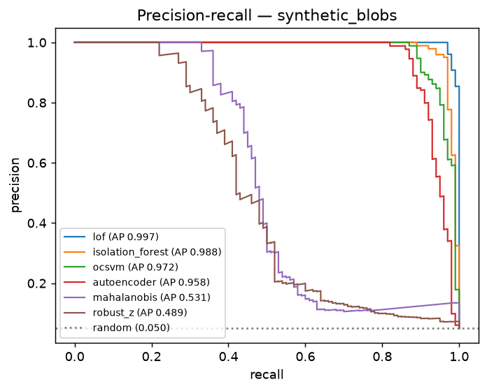
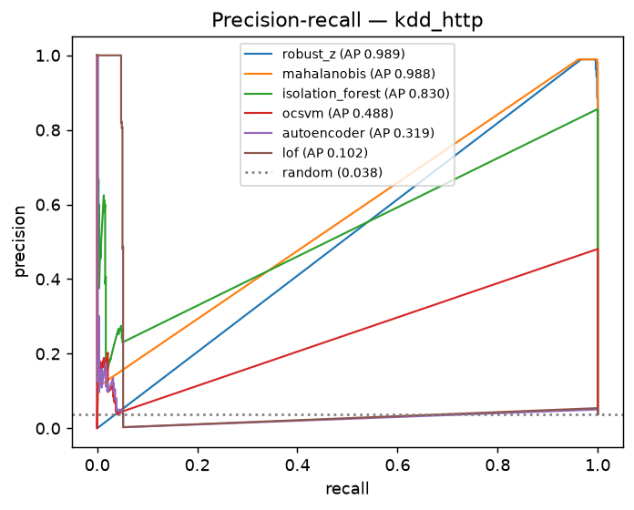
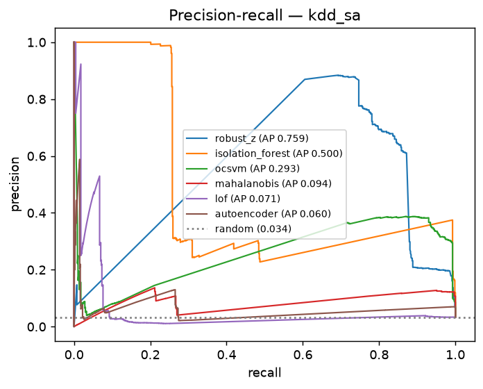
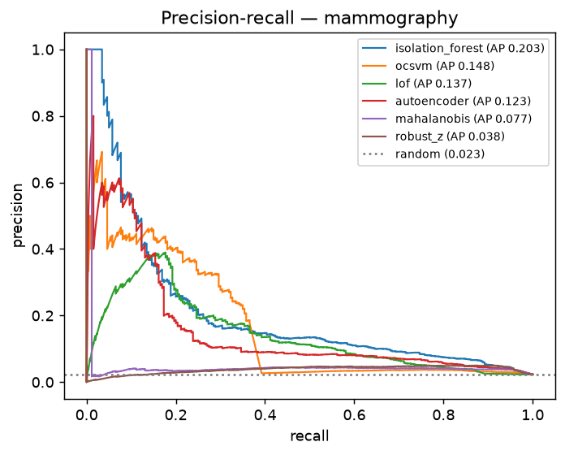

# A3b — Anomaly detection: statistics vs. classical ML vs. neural networks

Unsupervised: detectors never see labels; labels are used only to score them. PR-AUC is the headline metric because anomalies are rare. Randomized detectors averaged over 5 seeds. Results in [`results/a3_anomaly.csv`](results/a3_anomaly.csv).

| Detector | Family | synthetic_blobs | kdd_http | kdd_sa | mammography | avg rank |
|---|---|---|---|---|---|---|
| isolation_forest | classical ML | 0.988 | 0.830 | 0.500 | 0.203 | 2.00 |
| ocsvm | classical ML | 0.972 | 0.488 | 0.293 | 0.148 | 3.00 |
| robust_z | statistical | 0.489 | 0.989 | 0.759 | 0.038 | 3.50 |
| lof | classical ML | 0.997 | 0.102 | 0.071 | 0.137 | 3.75 |
| mahalanobis | statistical | 0.531 | 0.988 | 0.094 | 0.077 | 4.00 |
| autoencoder | neural network | 0.958 | 0.319 | 0.060 | 0.123 | 4.75 |

Friedman test on PR-AUC across 4 datasets: p = 0.4159 — with this few datasets only very large rank differences can reach significance (see A4 for the multi-dataset analysis).

## `synthetic_blobs`

synthetic · 2,000 rows × 4 features · contamination 5.00% (= PR-AUC of a random detector) · n = 100 anomalies

| Detector | Family | PR-AUC (mean over seeds) | ± seed std | 95% bootstrap CI (first seed) | ROC-AUC | Precision@n |
|---|---|---|---|---|---|---|
| **lof** | classical ML | 0.997 | — | [0.993, 1.000] | 1.000 | 0.970 |
| isolation_forest | classical ML | 0.988 | 0.002 | [0.967, 0.998] | 0.999 | 0.962 |
| ocsvm | classical ML | 0.972 | 0.000 | [0.944, 0.990] | 0.996 | 0.900 |
| autoencoder | neural network | 0.958 | 0.007 | [0.903, 0.977] | 0.989 | 0.918 |
| mahalanobis | statistical | 0.531 | 0.000 | [0.439, 0.626] | 0.864 | 0.480 |
| robust_z | statistical | 0.489 | — | [0.389, 0.586] | 0.832 | 0.470 |

## `kdd_http`

KDD Cup 1999 (10%) (subsample 20000) · 20,000 rows × 3 features · contamination 3.76% (= PR-AUC of a random detector) · n = 752 anomalies

| Detector | Family | PR-AUC (mean over seeds) | ± seed std | 95% bootstrap CI (first seed) | ROC-AUC | Precision@n |
|---|---|---|---|---|---|---|
| **robust_z** | statistical | 0.989 | — | [0.981, 0.996] | 1.000 | 0.989 |
| mahalanobis | statistical | 0.988 | 0.000 | [0.980, 0.996] | 1.000 | 0.989 |
| isolation_forest | classical ML | 0.830 | 0.015 | [0.805, 0.856] | 0.994 | 0.831 |
| ocsvm | classical ML | 0.488 | 0.016 | [0.437, 0.488] | 0.962 | 0.051 |
| autoencoder | neural network | 0.319 | 0.244 | [0.050, 0.063] | 0.723 | 0.164 |
| lof | classical ML | 0.102 | — | [0.087, 0.118] | 0.353 | 0.052 |

## `kdd_sa`

KDD Cup 1999 (10%) (subsample 20000) · 20,000 rows × 75 features · contamination 3.36% (= PR-AUC of a random detector) · n = 671 anomalies

| Detector | Family | PR-AUC (mean over seeds) | ± seed std | 95% bootstrap CI (first seed) | ROC-AUC | Precision@n |
|---|---|---|---|---|---|---|
| **robust_z** | statistical | 0.759 | — | [0.725, 0.793] | 0.979 | 0.765 |
| isolation_forest | classical ML | 0.500 | 0.039 | [0.486, 0.543] | 0.957 | 0.293 |
| ocsvm | classical ML | 0.293 | 0.010 | [0.292, 0.335] | 0.950 | 0.066 |
| mahalanobis | statistical | 0.094 | 0.028 | [0.096, 0.111] | 0.758 | 0.051 |
| lof | classical ML | 0.071 | — | [0.056, 0.090] | 0.331 | 0.076 |
| autoencoder | neural network | 0.060 | 0.007 | [0.062, 0.082] | 0.609 | 0.027 |

## `mammography`

OpenML #310 · 11,183 rows × 6 features · contamination 2.32% (= PR-AUC of a random detector) · n = 260 anomalies

| Detector | Family | PR-AUC (mean over seeds) | ± seed std | 95% bootstrap CI (first seed) | ROC-AUC | Precision@n |
|---|---|---|---|---|---|---|
| **isolation_forest** | classical ML | 0.203 | 0.012 | [0.163, 0.264] | 0.860 | 0.222 |
| ocsvm | classical ML | 0.148 | 0.011 | [0.121, 0.220] | 0.690 | 0.275 |
| lof | classical ML | 0.137 | — | [0.107, 0.174] | 0.773 | 0.235 |
| autoencoder | neural network | 0.123 | 0.080 | [0.115, 0.205] | 0.783 | 0.172 |
| mahalanobis | statistical | 0.077 | 0.043 | [0.037, 0.066] | 0.720 | 0.074 |
| robust_z | statistical | 0.038 | — | [0.033, 0.044] | 0.721 | 0.004 |

