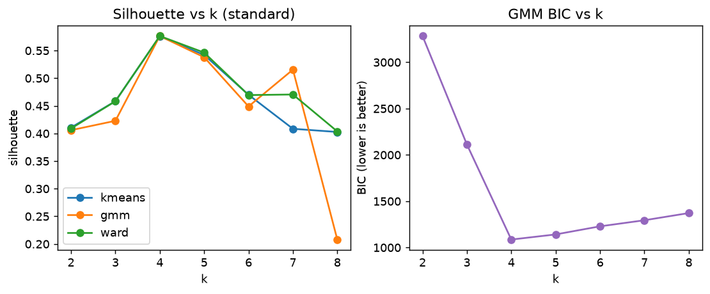
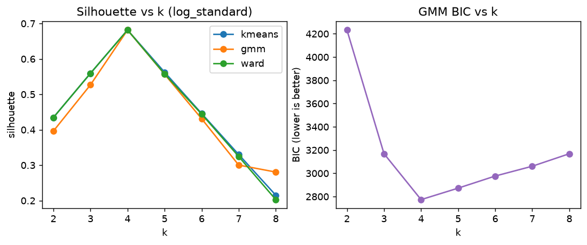
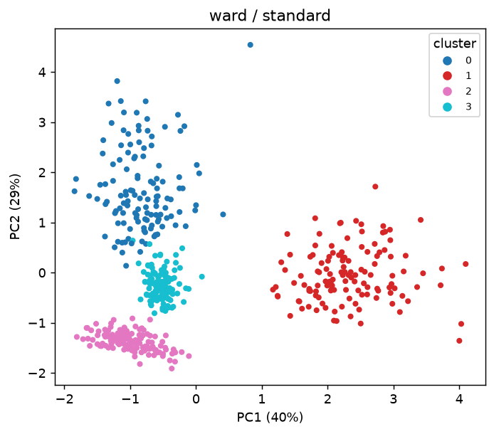
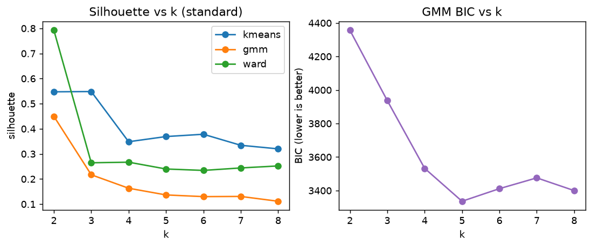
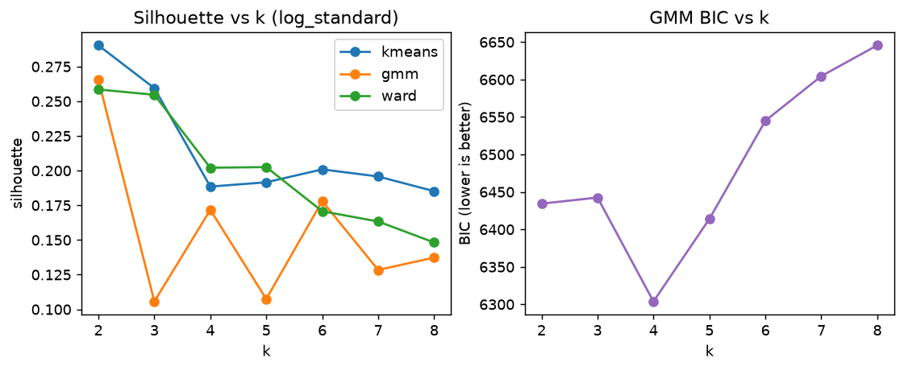
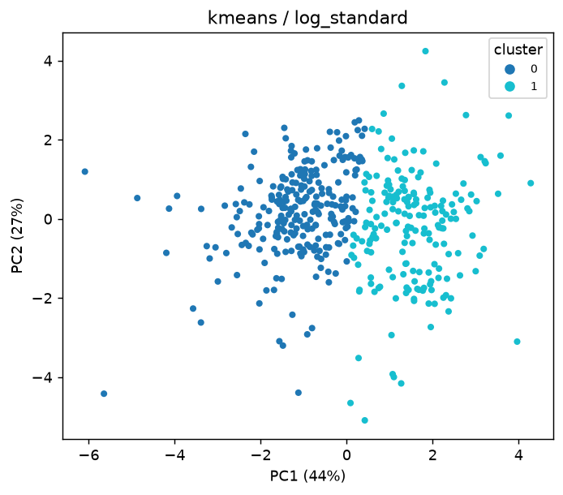

# A3a — Clustering: are the segments real?

k chosen by silhouette over k = 2…8 · stability = mean ARI between the full-data clustering and 100 refits on 80% subsamples · results in [`results/a3_clustering.csv`](results/a3_clustering.csv)

## `synthetic_blobs`

500 rows × 5 features · external label: true cluster

### Preprocessing: `standard`

### Preprocessing: `log_standard`

### Comparison

| Algorithm / preprocessing | k | noise | silhouette ↑ | Davies-Bouldin ↓ | bootstrap ARI (100×, 95% interval) ↑ | ARI vs external ↑ | NMI vs external ↑ |
|---|---|---|---|---|---|---|---|
| ward / standard | 4 | 0% | 0.576 | 0.632 | 1.000 [1.00, 1.00] | 1.000 | 1.000 |
| kmeans / log_standard | 4 | 0% | 0.682 | 0.457 | 1.000 [1.00, 1.00] | 1.000 | 1.000 |
| gmm / log_standard | 4 | 0% | 0.682 | 0.457 | 1.000 [1.00, 1.00] | 1.000 | 1.000 |
| ward / log_standard | 4 | 0% | 0.682 | 0.457 | 1.000 [1.00, 1.00] | 1.000 | 1.000 |
| hdbscan / log_standard | 4 | 0% | 0.682 | 0.457 | 1.000 [1.00, 1.00] | 1.000 | 1.000 |
| gmm / standard | 4 | 0% | 0.576 | 0.632 | 1.000 [1.00, 1.00] | 1.000 | 1.000 |
| kmeans / standard | 4 | 0% | 0.576 | 0.630 | 0.999 [0.99, 1.00] | 0.989 | 0.983 |
| hdbscan / standard | 4 | 5% | 0.602 | 0.589 | 0.985 [0.97, 1.00] | 0.932 | 0.929 |
| dbscan / log_standard | 4 | 3% | 0.688 | 0.448 | 0.978 [0.96, 0.99] | 0.961 | 0.943 |
| dbscan / standard | 3 | 2% | 0.430 | 0.910 | 0.898 [0.71, 1.00] | 0.700 | 0.828 |

Rows marked ⚠ found fewer than 2 clusters or labelled most points as noise: such trivial solutions look perfectly stable, so they are ranked last. Silhouette and Davies-Bouldin are computed in each preprocessing's own feature space, so they compare algorithms *within* a preprocessing, not across them. Stability and external agreement are comparable across all rows.

### Profile of the most stable solution: `ward / standard`

Median annual spend per cluster (original units):

| Cluster | size | x0 | x1 | x2 | x3 | x4 |
|---|---|---|---|---|---|---|
| 0 | 125 | 536 | 9316 | 3372 | 1575 | 180 |
| 1 | 125 | 178 | 113 | 6337 | 1745 | 2922 |
| 2 | 125 | 90 | 10864 | 5294 | 243 | 202 |
| 3 | 125 | 204 | 371 | 1095 | 716 | 382 |

Cross-tabulation with true cluster:

| Cluster | 0 | 1 | 2 | 3 |
|---|---|---|---|---|
| 0 | 125 | 0 | 0 | 0 |
| 1 | 0 | 125 | 0 | 0 |
| 2 | 0 | 0 | 125 | 0 |
| 3 | 0 | 0 | 0 | 125 |

## `wholesale`

440 rows × 6 features · external label: Channel (Horeca/Retail)

### Preprocessing: `standard`

### Preprocessing: `log_standard`

### Comparison

| Algorithm / preprocessing | k | noise | silhouette ↑ | Davies-Bouldin ↓ | bootstrap ARI (100×, 95% interval) ↑ | ARI vs external ↑ | NMI vs external ↑ |
|---|---|---|---|---|---|---|---|
| kmeans / log_standard | 2 | 0% | 0.290 | 1.352 | 0.959 [0.83, 1.00] | 0.514 | 0.445 |
| gmm / log_standard | 2 | 0% | 0.266 | 1.391 | 0.848 [0.72, 0.98] | 0.622 | 0.511 |
| kmeans / standard | 3 | 0% | 0.548 | 0.928 | 0.731 [0.35, 1.00] | 0.234 | 0.236 |
| gmm / standard | 2 | 0% | 0.450 | 1.908 | 0.660 [0.07, 0.98] | 0.096 | 0.038 |
| ward / log_standard | 2 | 0% | 0.258 | 1.600 | 0.528 [0.19, 0.86] | 0.539 | 0.447 |
| ward / standard | 2 | 0% | 0.792 | 0.909 | 0.292 [0.03, 1.00] | 0.023 | 0.022 |
| dbscan / standard ⚠ degenerate | 1 | 4% | nan | nan | 0.952 [0.90, 1.00] | 0.027 | 0.012 |
| dbscan / log_standard ⚠ degenerate | 1 | 6% | nan | nan | 0.911 [0.82, 0.97] | -0.023 | 0.007 |
| hdbscan / standard ⚠ degenerate | 0 | 100% | nan | nan | 0.910 [0.00, 1.00] | 0.000 | 0.000 |
| hdbscan / log_standard ⚠ degenerate | 2 | 81% | 0.572 | 0.645 | 0.805 [0.61, 0.91] | 0.059 | 0.138 |

Rows marked ⚠ found fewer than 2 clusters or labelled most points as noise: such trivial solutions look perfectly stable, so they are ranked last. Silhouette and Davies-Bouldin are computed in each preprocessing's own feature space, so they compare algorithms *within* a preprocessing, not across them. Stability and external agreement are comparable across all rows.

### Profile of the most stable solution: `kmeans / log_standard`

Median annual spend per cluster (original units):

| Cluster | size | Fresh | Milk | Grocery | Frozen | Detergents_Paper | Delicassen |
|---|---|---|---|---|---|---|---|
| 0 | 252 | 10348 | 1871 | 2406 | 2225 | 328 | 750 |
| 1 | 188 | 5406 | 7690 | 11527 | 1062 | 4495 | 1388 |

Cross-tabulation with Channel (Horeca/Retail):

| Cluster | 1 | 2 |
|---|---|---|
| 0 | 244 | 8 |
| 1 | 54 | 134 |

### Versus the original K-Means study

`kmeans / standard` reproduces the original setup (K-Means on standardized raw spend); with k chosen by silhouette it gives k = 3 and silhouette 0.548 (original study: K = 3, ≈ 0.548). The table above shows how far that solution is from the most stable one.
