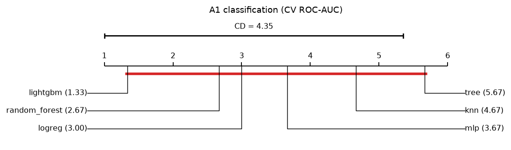
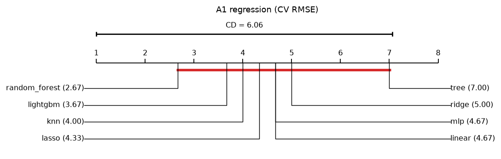
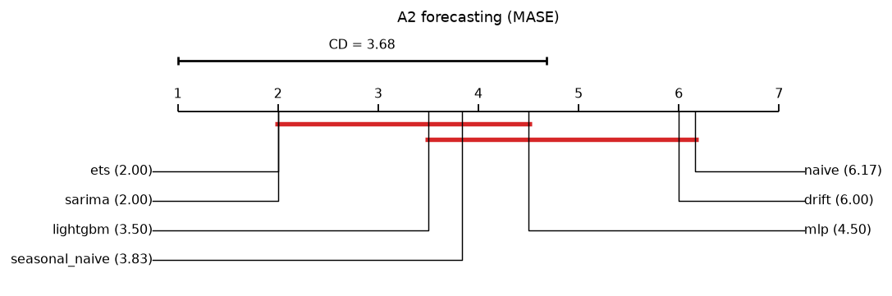
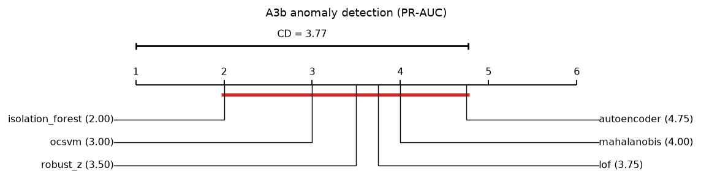

# A4 — Do some models win in general? A multi-dataset statistical comparison

Each dataset is one observation: models are ranked within every dataset and the ranks are compared (Friedman → Nemenyi / Wilcoxon-Holm). Within a dataset, scores are means over CV folds (A1, suite), backtest origins (A2) or seeds (A3b).

## OpenML-CC18 binary suite (12 datasets, CV ROC-AUC)

12 datasets × 7 models · metric `roc_auc` (higher is better) · α = 0.05

| Model | Family | Avg rank | Mean roc_auc | W–L vs `random_forest` | Wilcoxon p | Holm-adjusted p | Within CD of `random_forest`? |
|---|---|---|---|---|---|---|---|
| **random_forest** | classical ML | 2.00 | 0.8793 | — | — | — | — |
| lightgbm | classical ML | 2.83 | 0.8691 | 5–7 | 0.0923 | 0.1846 | yes |
| logreg | statistical | 3.17 | 0.8636 | 3–9 | 0.1099 | 0.1846 | yes |
| svm | classical ML | 3.83 | 0.8397 | 2–10 | 0.0034 | 0.0103 | yes |
| knn | classical ML | 4.67 | 0.8508 | 1–11 | 0.0015 | 0.0059 | no |
| mlp | neural network | 4.83 | 0.8213 | 1–11 | 0.0010 | 0.0049 | no |
| tree | classical ML | 6.67 | 0.7965 | 0–12 | 0.0005 | 0.0029 | no |

Friedman χ² = 36.86, p = < 0.0001 → the models do **not** all perform the same.
Nemenyi critical difference = 2.60 ranks. W–L: datasets where the model beat / lost to `random_forest`.

Per-dataset mean ROC-AUC

| Dataset | knn | lightgbm | logreg | mlp | random_forest | svm | tree |
|---|---|---|---|---|---|---|---|
| banknote | 0.9993 | 0.9999 | 0.9996 | 0.9978 | 0.9998 | 1.0000 | 0.9862 |
| blood_transfusion | 0.6937 | 0.6984 | 0.7515 | 0.6854 | 0.7117 | 0.6973 | 0.6822 |
| credit_g | 0.7463 | 0.7750 | 0.7836 | 0.7571 | 0.7936 | 0.7856 | 0.6746 |
| ilpd | 0.7047 | 0.7443 | 0.7500 | 0.6616 | 0.7528 | 0.6536 | 0.6505 |
| kc1 | 0.7800 | 0.7689 | 0.8014 | 0.7962 | 0.8232 | 0.6903 | 0.7355 |
| ozone_level | 0.8839 | 0.9234 | 0.9131 | 0.7643 | 0.9169 | 0.8927 | 0.6909 |
| pc1 | 0.7737 | 0.8541 | 0.8294 | 0.5713 | 0.8512 | 0.7235 | 0.7552 |
| phoneme | 0.9490 | 0.9566 | 0.8121 | 0.9150 | 0.9602 | 0.9099 | 0.9016 |
| pima_diabetes | 0.8006 | 0.7947 | 0.8297 | 0.8306 | 0.8290 | 0.8225 | 0.7494 |
| qsar_biodeg | 0.9181 | 0.9311 | 0.9277 | 0.9140 | 0.9368 | 0.9324 | 0.8477 |
| spambase | 0.9700 | 0.9893 | 0.9706 | 0.9773 | 0.9858 | 0.9742 | 0.9362 |
| wdbc | 0.9907 | 0.9933 | 0.9948 | 0.9846 | 0.9900 | 0.9949 | 0.9483 |

## A1 classification (CV ROC-AUC)

3 datasets × 6 models · metric `roc_auc` (higher is better) · α = 0.05

| Model | Family | Avg rank | Mean roc_auc | W–L vs `lightgbm` | Wilcoxon p | Holm-adjusted p | Within CD of `lightgbm`? |
|---|---|---|---|---|---|---|---|
| **lightgbm** | classical ML | 1.33 | 0.9470 | — | — | — | — |
| random_forest | classical ML | 2.67 | 0.9422 | 0–3 | 0.2500 | 1.0000 | yes |
| logreg | statistical | 3.00 | 0.9354 | 1–2 | 0.5000 | 1.0000 | yes |
| mlp | neural network | 3.67 | 0.9315 | 0–3 | 0.2500 | 1.0000 | yes |
| knn | classical ML | 4.67 | 0.9170 | 0–3 | 0.2500 | 1.0000 | yes |
| tree | classical ML | 5.67 | 0.8908 | 0–3 | 0.2500 | 1.0000 | yes |

Friedman χ² = 10.05, p = 0.0739 → no evidence that the models differ; post-hoc results below are descriptive only.
Nemenyi critical difference = 4.35 ranks. W–L: datasets where the model beat / lost to `lightgbm`.

With only 3 datasets the Wilcoxon test cannot reach p < 0.05 (its smallest attainable p-value is 2 / 2^n); treat this section as descriptive.

## A1 regression (CV RMSE)

3 datasets × 8 models · metric `rmse` (lower is better) · α = 0.05

| Model | Family | Avg rank | Datasets won | W–L vs `random_forest` | Wilcoxon p | Holm-adjusted p | Within CD of `random_forest`? |
|---|---|---|---|---|---|---|---|
| **random_forest** | classical ML | 2.67 | 1/3 | — | — | — | — |
| lightgbm | classical ML | 3.67 | 1/3 | 1–2 | 0.7500 | 1.0000 | yes |
| knn | classical ML | 4.00 | 0/3 | 0–3 | 0.2500 | 1.0000 | yes |
| lasso | statistical | 4.33 | 1/3 | 1–2 | 1.0000 | 1.0000 | yes |
| linear | statistical | 4.67 | 0/3 | 1–2 | 1.0000 | 1.0000 | yes |
| mlp | neural network | 4.67 | 0/3 | 1–2 | 0.7500 | 1.0000 | yes |
| ridge | statistical | 5.00 | 0/3 | 1–2 | 1.0000 | 1.0000 | yes |
| tree | classical ML | 7.00 | 0/3 | 0–3 | 0.2500 | 1.0000 | yes |

Friedman χ² = 5.44, p = 0.6059 → no evidence that the models differ; post-hoc results below are descriptive only.
Nemenyi critical difference = 6.06 ranks. W–L: datasets where the model beat / lost to `random_forest`.

With only 3 datasets the Wilcoxon test cannot reach p < 0.05 (its smallest attainable p-value is 2 / 2^n); treat this section as descriptive.

## A2 forecasting (MASE)

6 datasets × 7 models · metric `mase` (lower is better) · α = 0.05

| Model | Family | Avg rank | Mean mase | W–L vs `ets` | Wilcoxon p | Holm-adjusted p | Within CD of `ets`? |
|---|---|---|---|---|---|---|---|
| **ets** | statistical | 2.00 | 1.0149 | — | — | — | — |
| sarima | statistical | 2.00 | 1.0135 | 3–3 | 0.8438 | 0.8438 | yes |
| lightgbm | classical ML | 3.50 | 1.4984 | 1–5 | 0.0625 | 0.2500 | yes |
| seasonal_naive | baseline | 3.83 | 1.8334 | 1–5 | 0.0625 | 0.2500 | yes |
| mlp | neural network | 4.50 | 3.2091 | 1–5 | 0.0625 | 0.2500 | yes |
| drift | baseline | 6.00 | 4.1463 | 0–6 | 0.0312 | 0.1875 | no |
| naive | baseline | 6.17 | 4.5269 | 0–6 | 0.0312 | 0.1875 | no |

Friedman χ² = 22.14, p = 0.0011 → the models do **not** all perform the same.
Nemenyi critical difference = 3.68 ranks. W–L: datasets where the model beat / lost to `ets`.

## A3b anomaly detection (PR-AUC)

4 datasets × 6 models · metric `pr_auc` (higher is better) · α = 0.05

| Model | Family | Avg rank | Mean pr_auc | W–L vs `isolation_forest` | Wilcoxon p | Holm-adjusted p | Within CD of `isolation_forest`? |
|---|---|---|---|---|---|---|---|
| **isolation_forest** | classical ML | 2.00 | 0.6303 | — | — | — | — |
| ocsvm | classical ML | 3.00 | 0.4750 | 0–4 | 0.1250 | 0.6250 | yes |
| robust_z | statistical | 3.50 | 0.5687 | 2–2 | 0.8750 | 0.8750 | yes |
| lof | classical ML | 3.75 | 0.3269 | 1–3 | 0.2500 | 0.7500 | yes |
| mahalanobis | statistical | 4.00 | 0.4224 | 1–3 | 0.3750 | 0.7500 | yes |
| autoencoder | neural network | 4.75 | 0.3648 | 0–4 | 0.1250 | 0.6250 | yes |

Friedman χ² = 5.00, p = 0.4159 → no evidence that the models differ; post-hoc results below are descriptive only.
Nemenyi critical difference = 3.77 ranks. W–L: datasets where the model beat / lost to `isolation_forest`.

With only 4 datasets the Wilcoxon test cannot reach p < 0.05 (its smallest attainable p-value is 2 / 2^n); treat this section as descriptive.

