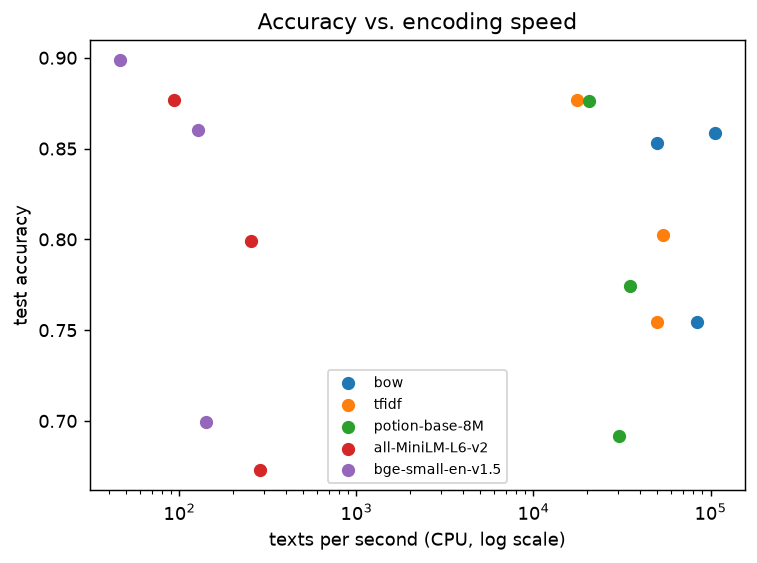
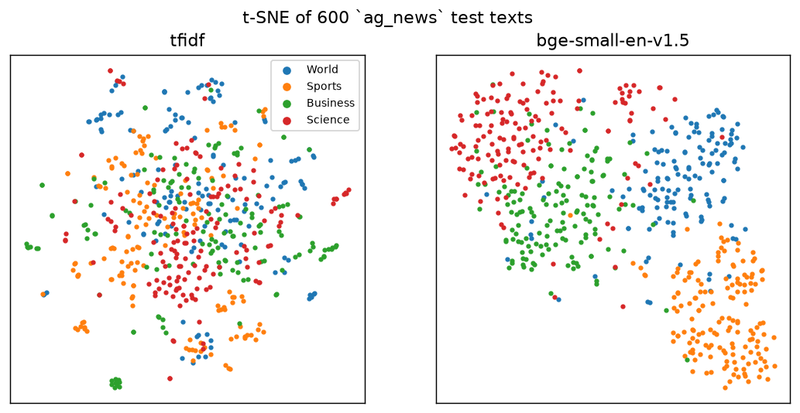

# B1 — Text representations: sparse vs. static vs. contextual embeddings

Same classifier for every representation (logistic regression, C ∈ {0.1, 1, 10} by 3-fold CV); test accuracy with 95% bootstrap CI; McNemar against the best representation of each dataset. Results in [`results/b1_representations.csv`](results/b1_representations.csv).

| Representation | Family | ag_news | sst2 | emotion | avg rank |
|---|---|---|---|---|---|
| bge-small-en-v1.5 | sentence transformer | 0.8985 | 0.8601 | 0.6995 | 1.67 |
| tfidf | sparse | 0.8765 | 0.7546 | 0.8025 | 3.00 |
| all-MiniLM-L6-v2 | sentence transformer | 0.8765 | 0.7993 | 0.6730 | 3.17 |
| bow | sparse | 0.8530 | 0.7546 | 0.8585 | 3.50 |
| potion-base-8M | static embeddings | 0.8760 | 0.7741 | 0.6915 | 3.67 |

Friedman across 3 datasets: p = 0.5407.

## `ag_news`

HF `fancyzhx/ag_news` · 4 classes (World, Sports, Business, Science) · train 5,000 / test 2,000

| Representation | Family | Accuracy (95% CI) | Macro-F1 | Dim | Non-zeros | Texts/s (CPU) | McNemar p vs best |
|---|---|---|---|---|---|---|---|
| **bge-small-en-v1.5** | sentence transformer | 0.8985 [0.8850, 0.9115] | 0.8983 | 384 | 100.00% | 46 | — |
| tfidf | sparse | 0.8765 [0.8620, 0.8910] | 0.8762 | 28,930 | 0.16% | 17,574 | 0.0013 |
| all-MiniLM-L6-v2 | sentence transformer | 0.8765 [0.8615, 0.8915] | 0.8764 | 384 | 100.00% | 93 | < 0.0001 |
| potion-base-8M | static embeddings | 0.8760 [0.8610, 0.8910] | 0.8758 | 256 | 100.00% | 20,536 | 0.0003 |
| bow | sparse | 0.8530 [0.8385, 0.8690] | 0.8526 | 9,535 | 0.31% | 50,021 | < 0.0001 |

## `sst2`

HF `stanfordnlp/sst2` · 2 classes (negative, positive) · train 5,000 / test 872

| Representation | Family | Accuracy (95% CI) | Macro-F1 | Dim | Non-zeros | Texts/s (CPU) | McNemar p vs best |
|---|---|---|---|---|---|---|---|
| **bge-small-en-v1.5** | sentence transformer | 0.8601 [0.8360, 0.8819] | 0.8599 | 384 | 100.00% | 128 | — |
| all-MiniLM-L6-v2 | sentence transformer | 0.7993 [0.7718, 0.8245] | 0.7993 | 384 | 100.00% | 254 | < 0.0001 |
| potion-base-8M | static embeddings | 0.7741 [0.7454, 0.7993] | 0.7736 | 256 | 100.00% | 34,998 | < 0.0001 |
| bow | sparse | 0.7546 [0.7248, 0.7833] | 0.7536 | 3,908 | 0.19% | 83,985 | < 0.0001 |
| tfidf | sparse | 0.7546 [0.7259, 0.7844] | 0.7537 | 10,423 | 0.11% | 49,684 | < 0.0001 |

## `emotion`

HF `dair-ai/emotion` · 6 classes (sadness, joy, love, anger, fear, surprise) · train 5,000 / test 2,000

| Representation | Family | Accuracy (95% CI) | Macro-F1 | Dim | Non-zeros | Texts/s (CPU) | McNemar p vs best |
|---|---|---|---|---|---|---|---|
| **bow** | sparse | 0.8585 [0.8430, 0.8740] | 0.7941 | 3,660 | 0.41% | 106,050 | — |
| tfidf | sparse | 0.8025 [0.7850, 0.8200] | 0.7116 | 12,488 | 0.19% | 54,156 | < 0.0001 |
| bge-small-en-v1.5 | sentence transformer | 0.6995 [0.6805, 0.7190] | 0.6037 | 384 | 100.00% | 141 | < 0.0001 |
| potion-base-8M | static embeddings | 0.6915 [0.6715, 0.7115] | 0.6299 | 256 | 100.00% | 30,592 | < 0.0001 |
| all-MiniLM-L6-v2 | sentence transformer | 0.6730 [0.6525, 0.6925] | 0.5501 | 384 | 100.00% | 286 | < 0.0001 |
