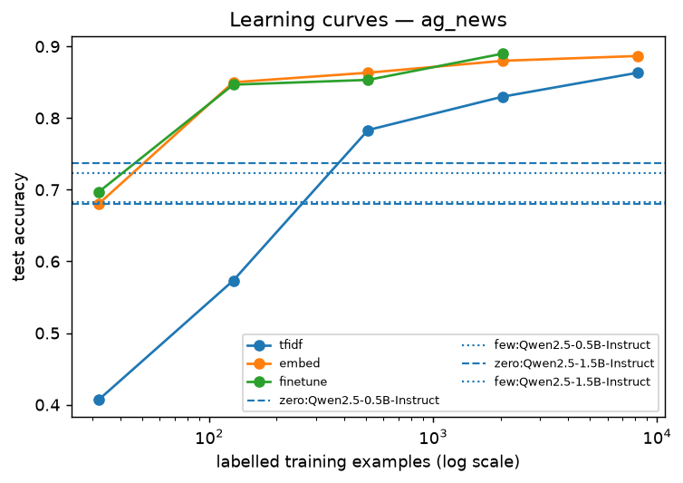
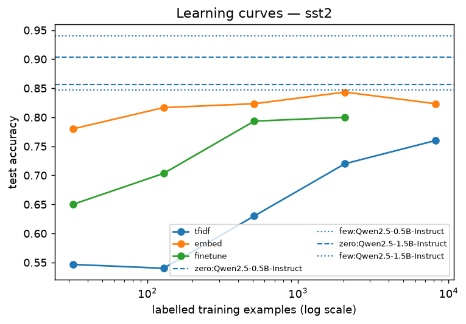
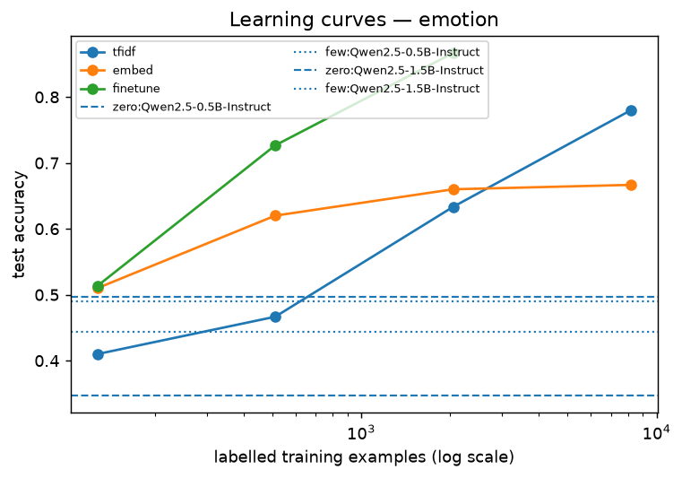

# B2 — Text classification: TF-IDF → embeddings → fine-tuning → prompting

Accuracy of each method at its largest training size (LLM rows use 0 or one example per class). LLMs choose a label by comparing label log-probabilities, so every answer is valid. Results per training size in [`results/b2_classification.csv`](results/b2_classification.csv).

Timings measured on: AMD EPYC 7763 64-Core Processor, 4 logical CPUs, Linux; AMD EPYC 9V45 96-Core Processor, 4 logical CPUs, Linux. LLM inference time is the median per text (robust to one-off stalls).

| Method | ag_news | sst2 | emotion | avg rank |
|---|---|---|---|---|
| finetune | 0.8900 | 0.8000 | 0.8667 | 2.67 |
| embed | 0.8867 | 0.8233 | 0.6667 | 3.33 |
| zero:Qwen2.5-1.5B-Instruct | 0.7367 | 0.9033 | 0.4967 | 3.33 |
| few:Qwen2.5-1.5B-Instruct | 0.7233 | 0.9400 | 0.4900 | 3.67 |
| tfidf | 0.8633 | 0.7600 | 0.7800 | 4.00 |
| few:Qwen2.5-0.5B-Instruct | 0.6833 | 0.8467 | 0.4433 | 5.33 |
| zero:Qwen2.5-0.5B-Instruct | 0.6800 | 0.8567 | 0.3467 | 5.67 |

## `ag_news`

HF `fancyzhx/ag_news` · 4 classes · test 300 texts · training subsets are nested

| Method | Labelled examples | Accuracy (95% CI) | Train s | Inference ms/text | McNemar p vs best |
|---|---|---|---|---|---|
| **finetune** | 2,048 | 0.8900 [0.8533, 0.9233] | 908.1 | 39.8 | — |
| embed | 8,192 | 0.8867 [0.8467, 0.9200] | 173.9 | 25.2 | 1.0000 |
| tfidf | 8,192 | 0.8633 [0.8233, 0.9000] | 5.2 | 0.080 | 0.0963 |
| zero:Qwen2.5-1.5B-Instruct | 0 | 0.7367 [0.6833, 0.7833] | 0.0 | 1,628.6 | < 0.0001 |
| few:Qwen2.5-1.5B-Instruct | 4 | 0.7233 [0.6700, 0.7700] | 0.0 | 1,636.7 | < 0.0001 |
| few:Qwen2.5-0.5B-Instruct | 4 | 0.6833 [0.6300, 0.7333] | 0.0 | 528.3 | < 0.0001 |
| zero:Qwen2.5-0.5B-Instruct | 0 | 0.6800 [0.6233, 0.7300] | 0.0 | 517.2 | < 0.0001 |

Labelled examples a trained model needs to beat each LLM setting:

| LLM setting | Trained method | Examples needed |
|---|---|---|
| zero:Qwen2.5-0.5B-Instruct | tfidf | 512 |
| zero:Qwen2.5-0.5B-Instruct | embed | 128 |
| zero:Qwen2.5-0.5B-Instruct | finetune | 32 |
| few:Qwen2.5-0.5B-Instruct | tfidf | 512 |
| few:Qwen2.5-0.5B-Instruct | embed | 128 |
| few:Qwen2.5-0.5B-Instruct | finetune | 32 |
| zero:Qwen2.5-1.5B-Instruct | tfidf | 512 |
| zero:Qwen2.5-1.5B-Instruct | embed | 128 |
| zero:Qwen2.5-1.5B-Instruct | finetune | 128 |
| few:Qwen2.5-1.5B-Instruct | tfidf | 512 |
| few:Qwen2.5-1.5B-Instruct | embed | 128 |
| few:Qwen2.5-1.5B-Instruct | finetune | 128 |

## `sst2`

HF `stanfordnlp/sst2` · 2 classes · test 300 texts · training subsets are nested

| Method | Labelled examples | Accuracy (95% CI) | Train s | Inference ms/text | McNemar p vs best |
|---|---|---|---|---|---|
| **few:Qwen2.5-1.5B-Instruct** | 2 | 0.9400 [0.9100, 0.9667] | 0.0 | 828.2 | — |
| zero:Qwen2.5-1.5B-Instruct | 0 | 0.9033 [0.8700, 0.9367] | 0.0 | 824.6 | 0.0192 |
| zero:Qwen2.5-0.5B-Instruct | 0 | 0.8567 [0.8166, 0.8967] | 0.0 | 270.3 | < 0.0001 |
| few:Qwen2.5-0.5B-Instruct | 2 | 0.8467 [0.8033, 0.8867] | 0.0 | 270.0 | < 0.0001 |
| embed | 8,192 | 0.8233 [0.7767, 0.8667] | 32.9 | 7.3 | < 0.0001 |
| finetune | 2,048 | 0.8000 [0.7566, 0.8433] | 324.8 | 17.9 | < 0.0001 |
| tfidf | 8,192 | 0.7600 [0.7133, 0.8033] | 1.3 | 0.026 | < 0.0001 |

Labelled examples a trained model needs to beat each LLM setting:

| LLM setting | Trained method | Examples needed |
|---|---|---|
| zero:Qwen2.5-0.5B-Instruct | tfidf | > 8,192 |
| zero:Qwen2.5-0.5B-Instruct | embed | > 8,192 |
| zero:Qwen2.5-0.5B-Instruct | finetune | > 2,048 |
| few:Qwen2.5-0.5B-Instruct | tfidf | > 8,192 |
| few:Qwen2.5-0.5B-Instruct | embed | > 8,192 |
| few:Qwen2.5-0.5B-Instruct | finetune | > 2,048 |
| zero:Qwen2.5-1.5B-Instruct | tfidf | > 8,192 |
| zero:Qwen2.5-1.5B-Instruct | embed | > 8,192 |
| zero:Qwen2.5-1.5B-Instruct | finetune | > 2,048 |
| few:Qwen2.5-1.5B-Instruct | tfidf | > 8,192 |
| few:Qwen2.5-1.5B-Instruct | embed | > 8,192 |
| few:Qwen2.5-1.5B-Instruct | finetune | > 2,048 |

## `emotion`

HF `dair-ai/emotion` · 6 classes · test 300 texts · training subsets are nested

| Method | Labelled examples | Accuracy (95% CI) | Train s | Inference ms/text | McNemar p vs best |
|---|---|---|---|---|---|
| **finetune** | 2,048 | 0.8667 [0.8233, 0.9033] | 414.1 | 18.5 | — |
| tfidf | 8,192 | 0.7800 [0.7333, 0.8233] | 8.1 | 0.031 | 0.0010 |
| embed | 8,192 | 0.6667 [0.6133, 0.7167] | 58.4 | 7.2 | < 0.0001 |
| zero:Qwen2.5-1.5B-Instruct | 0 | 0.4967 [0.4433, 0.5533] | 0.0 | 1,582.9 | < 0.0001 |
| few:Qwen2.5-1.5B-Instruct | 6 | 0.4900 [0.4333, 0.5434] | 0.0 | 1,583.8 | < 0.0001 |
| few:Qwen2.5-0.5B-Instruct | 6 | 0.4433 [0.3867, 0.5033] | 0.0 | 542.3 | < 0.0001 |
| zero:Qwen2.5-0.5B-Instruct | 0 | 0.3467 [0.2933, 0.4067] | 0.0 | 532.6 | < 0.0001 |

Labelled examples a trained model needs to beat each LLM setting:

| LLM setting | Trained method | Examples needed |
|---|---|---|
| zero:Qwen2.5-0.5B-Instruct | tfidf | 128 |
| zero:Qwen2.5-0.5B-Instruct | embed | 128 |
| zero:Qwen2.5-0.5B-Instruct | finetune | 128 |
| few:Qwen2.5-0.5B-Instruct | tfidf | 512 |
| few:Qwen2.5-0.5B-Instruct | embed | 128 |
| few:Qwen2.5-0.5B-Instruct | finetune | 128 |
| zero:Qwen2.5-1.5B-Instruct | tfidf | 2,048 |
| zero:Qwen2.5-1.5B-Instruct | embed | 128 |
| zero:Qwen2.5-1.5B-Instruct | finetune | 128 |
| few:Qwen2.5-1.5B-Instruct | tfidf | 2,048 |
| few:Qwen2.5-1.5B-Instruct | embed | 128 |
| few:Qwen2.5-1.5B-Instruct | finetune | 128 |
