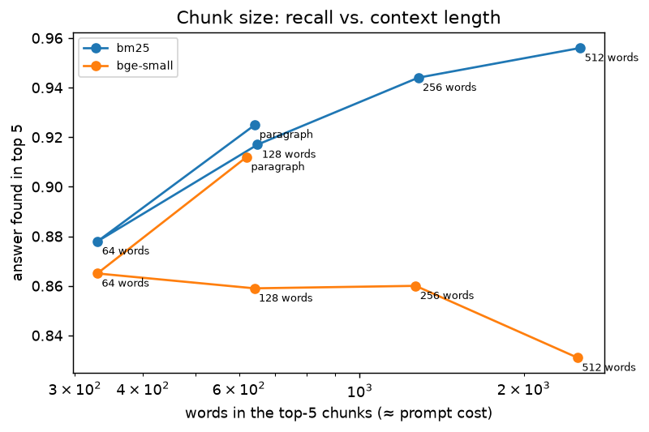

# B3 — Semantic search: BM25 vs. dense vs. hybrid vs. re-ranking

Dense retrievers use normalized embeddings in a FAISS inner-product index; hybrid = reciprocal-rank fusion (k = 60) of BM25 and the dense run; re-ranking = cross-encoder (`ms-marco-MiniLM-L-6-v2`) over the first stage's top 20. Significance: per-query nDCG@10, Wilcoxon signed-rank vs. the best retriever, Holm-adjusted. Per-query results in [`results/b3_search.csv`](results/b3_search.csv).

## `squad` — retrieval

SQuAD v1.1 dev (42 articles in corpus, 6 held out) · 1,783 passages · 1,000 queries

| Retriever | nDCG@10 | MRR@10 | Recall@1 | Recall@5 | Recall@10 | Index s | ms/query | Holm p vs best |
|---|---|---|---|---|---|---|---|---|
| **rerank(bm25+bge-small)** | 0.929 | 0.911 | 0.866 | 0.972 | 0.982 | 117.7 | 670.9 | — |
| bm25+bge-small | 0.869 | 0.836 | 0.756 | 0.939 | 0.971 | 118.6 | 6.4 | < 0.0001 |
| bm25 | 0.853 | 0.824 | 0.758 | 0.913 | 0.943 | 0.2 | 0.0 | < 0.0001 |
| tfidf | 0.811 | 0.777 | 0.699 | 0.888 | 0.917 | 0.5 | 0.1 | < 0.0001 |
| bge-small | 0.805 | 0.762 | 0.668 | 0.884 | 0.937 | 124.2 | 6.8 | < 0.0001 |
| MiniLM-L6-v2 | 0.765 | 0.718 | 0.613 | 0.866 | 0.909 | 63.1 | 2.4 | < 0.0001 |

## `squad` — chunk size

Articles re-split into windows with 25% overlap. Hit@k: a chunk from the right article containing a gold answer is in the top k.

| Retriever | Chunking | Chunks | Hit@1 | Hit@3 | Hit@5 | Words in top 5 |
|---|---|---|---|---|---|---|
| bm25 | paragraph | 1,783 | 0.793 | 0.896 | 0.925 | 642 |
| bm25 | 64 words | 4,629 | 0.678 | 0.839 | 0.878 | 330 |
| bm25 | 128 words | 2,316 | 0.745 | 0.881 | 0.917 | 649 |
| bm25 | 256 words | 1,164 | 0.793 | 0.910 | 0.944 | 1,280 |
| bm25 | 512 words | 583 | 0.820 | 0.936 | 0.956 | 2,540 |
| bge-small | paragraph | 1,783 | 0.709 | 0.872 | 0.912 | 620 |
| bge-small | 64 words | 4,629 | 0.624 | 0.816 | 0.865 | 330 |
| bge-small | 128 words | 2,316 | 0.575 | 0.786 | 0.859 | 640 |
| bge-small | 256 words | 1,164 | 0.544 | 0.788 | 0.860 | 1,266 |
| bge-small | 512 words | 583 | 0.537 | 0.756 | 0.831 | 2,511 |

## `scifact` — retrieval

BEIR SciFact (test qrels) · 5,183 passages · 300 queries

| Retriever | nDCG@10 | MRR@10 | Recall@1 | Recall@5 | Recall@10 | Index s | ms/query | Holm p vs best |
|---|---|---|---|---|---|---|---|---|
| **bm25+bge-small** | 0.707 | 0.674 | 0.564 | 0.775 | 0.826 | 614.5 | 11.1 | — |
| bge-small | 0.706 | 0.673 | 0.563 | 0.764 | 0.830 | 614.1 | 10.9 | 0.7573 |
| rerank(bm25+bge-small) | 0.696 | 0.661 | 0.549 | 0.746 | 0.833 | 622.1 | 1341.5 | 0.7048 |
| bm25 | 0.665 | 0.633 | 0.525 | 0.724 | 0.785 | 0.7 | 0.2 | 0.0012 |
| MiniLM-L6-v2 | 0.648 | 0.607 | 0.485 | 0.741 | 0.788 | 185.4 | 4.6 | 0.0019 |
| tfidf | 0.621 | 0.584 | 0.469 | 0.694 | 0.763 | 2.3 | 0.2 | < 0.0001 |
