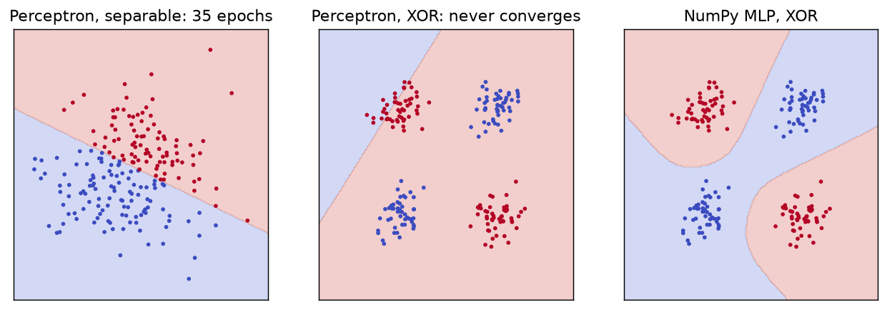
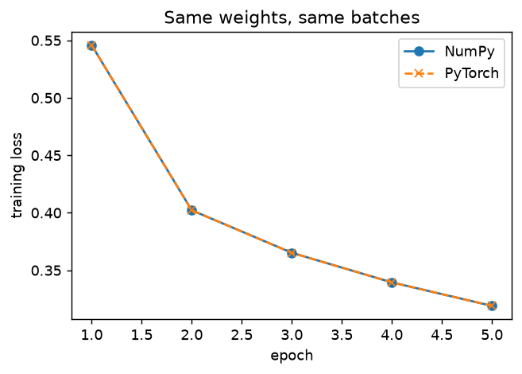
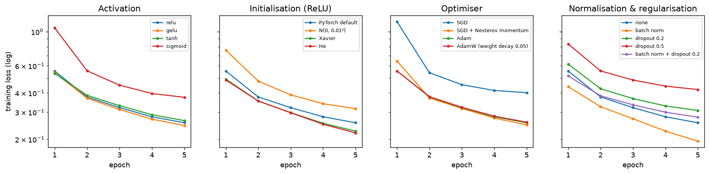

# C1 — Neural networks from first principles

HF `zalando-datasets/fashion_mnist` (train) · 60,000 training / 10,000 test images · results in [`results/c1_fundamentals.csv`](results/c1_fundamentals.csv)

## Perceptron vs. a hidden layer

| Model / data | Training accuracy |
|---|---|
| perceptron, separable | 100.0% |
| perceptron, XOR | 42.5% |
| 2-layer MLP (8 tanh units), XOR | 100.0% |

The perceptron stops after 35 epochs on separable data and is still making 91 mistakes per epoch on XOR after 100: no line separates XOR, while one hidden layer bends the boundary.

## Backpropagation by hand

A 784 → 128 → 64 → 10 ReLU network written in NumPy (forward pass, softmax cross-entropy, backpropagation and SGD with momentum).

| Check | Result |
|---|---|
| Gradient check, worst relative error per tensor | W1 1.3e-06, b1 2.6e-07, W2 4.3e-08, b2 7.6e-08, W3 3.7e-06, b3 9.4e-09 |
| Loss, NumPy vs. PyTorch on the same batch | 3.5277404364 vs. 3.5277404364 |
| Largest gradient difference vs. PyTorch autograd | 8.9e-16 |

Trained side by side for 5 epochs from identical weights on identical batches:

| Implementation | Test accuracy (95% CI) | Seconds / epoch |
|---|---|---|
| NumPy | 0.8614 [0.8548, 0.8678] | 0.7 |
| PyTorch | 0.8614 [0.8548, 0.8678] | 0.7 |

The two networks predict the same class for 100.00% of test images.

## Ablations of a deep MLP

784 → 256 → 256 → 256 → 256 → 10 network, 5 epochs, 3 seeds; one factor changed at a time from ReLU + PyTorch default init + Adam. McNemar: seed-0 predictions vs. the group's best.

**Activation**

| Variant | Test accuracy (mean ± std, 3 seeds) | McNemar p vs best |
|---|---|---|
| **gelu** | 0.8853 ± 0.0015 | — |
| relu | 0.8812 ± 0.0007 | 0.0025 |
| tanh | 0.8791 ± 0.0007 | 0.0007 |
| sigmoid | 0.8546 ± 0.0041 | < 0.0001 |

**Initialisation (ReLU)**

| Variant | Test accuracy (mean ± std, 3 seeds) | McNemar p vs best |
|---|---|---|
| **Xavier** | 0.8879 ± 0.0009 | — |
| He | 0.8868 ± 0.0003 | 0.3416 |
| PyTorch default | 0.8812 ± 0.0007 | < 0.0001 |
| N(0, 0.01²) | 0.8673 ± 0.0016 | < 0.0001 |

**Optimiser**

| Variant | Test accuracy (mean ± std, 3 seeds) | McNemar p vs best |
|---|---|---|
| **SGD + Nesterov momentum** | 0.8844 ± 0.0016 | — |
| AdamW (weight decay 0.05) | 0.8817 ± 0.0009 | 0.0713 |
| Adam | 0.8812 ± 0.0007 | 0.0025 |
| SGD | 0.8407 ± 0.0004 | < 0.0001 |

**Normalisation & regularisation**

| Variant | Test accuracy (mean ± std, 3 seeds) | McNemar p vs best |
|---|---|---|
| **batch norm** | 0.8966 ± 0.0009 | — |
| batch norm + dropout 0.2 | 0.8873 ± 0.0012 | < 0.0001 |
| none | 0.8812 ± 0.0007 | < 0.0001 |
| dropout 0.2 | 0.8749 ± 0.0020 | < 0.0001 |
| dropout 0.5 | 0.8571 ± 0.0018 | < 0.0001 |

