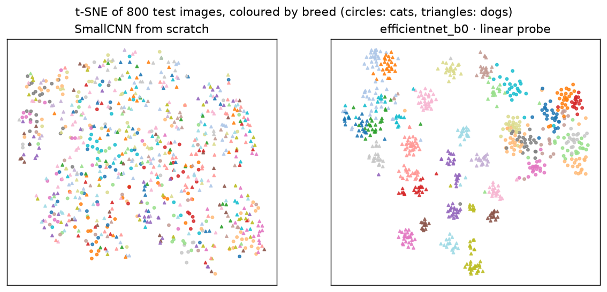

# C2 — CNNs and transfer learning

All training and timing on CPU. Results in [`results/c2_transfer.csv`](results/c2_transfer.csv).

## A. Inductive bias — MLP vs. CNN on CIFAR-10

HF `uoft-cs/cifar10` (train) · 50,000 training / 10,000 test images · same budget for both: 15 epochs, AdamW, cosine schedule, `flip+crop` augmentation.

| Model | Parameters | Test accuracy (95% CI) | Train min | Images/s (CPU) |
|---|---|---|---|---|
| MLP | 1,707,274 | 0.5536 [0.5445, 0.5633] | 2.0 | 30,521 |
| SmallCNN | 288,746 | 0.8544 [0.8472, 0.8609] | 24.4 | 3,494 |

McNemar SmallCNN vs. MLP: p = < 0.0001.

## B. Transfer learning — Oxford-IIIT Pets (37 breeds)

HF `timm/oxford-iiit-pet` (train) · 3,311 training / 369 validation / 3,669 test images at 160px. Pretrained backbones: ImageNet weights from timm.

| Method | Trainable / total params | Test accuracy (95% CI) | Train min | Images/s (CPU) | Notes | McNemar p vs best |
|---|---|---|---|---|---|---|
| **efficientnet_b0 · LP-FT, frozen BN** | 4,054,945 / 4,054,945 | 0.9054 [0.8956, 0.9144] | 2.9 | 88 | head = linear probe, then 3 epochs, lr 0.0001, BatchNorm statistics frozen | — |
| efficientnet_b0 · linear probe | 47,397 / 4,007,548 | 0.9035 [0.8934, 0.9131] | 0.6 | 86 | C = 0.01 | 0.6108 |
| deit_tiny_patch16_224 · linear probe | 7,141 / 5,505,984 | 0.8694 [0.8580, 0.8801] | 0.5 | 109 | C = 0.1 | < 0.0001 |
| resnet18 · linear probe | 18,981 / 11,176,512 | 0.8591 [0.8479, 0.8700] | 0.5 | 118 | C = 0.01 | < 0.0001 |
| resnet18 · LP-FT, frozen BN | 11,195,493 / 11,195,493 | 0.8564 [0.8455, 0.8670] | 2.5 | 110 | head = linear probe, then 3 epochs, lr 0.0001, BatchNorm statistics frozen | < 0.0001 |
| efficientnet_b0 · LP-FT | 4,054,945 / 4,054,945 | 0.8433 [0.8316, 0.8539] | 10.6 | 85 | head = linear probe, then 3 epochs, lr 0.0001 | < 0.0001 |
| mobilenetv3_small_100 · linear probe | 37,925 / 1,517,856 | 0.8190 [0.8059, 0.8310] | 0.1 | 569 | C = 0.1 | < 0.0001 |
| efficientnet_b0 · fine-tuned | 4,054,945 / 4,054,945 | 0.8043 [0.7912, 0.8166] | 16.9 | 86 | random head, 5 epochs, lr 0.0003 | < 0.0001 |
| mobilenetv3_small_100 · LP-FT, frozen BN | 1,555,781 / 1,555,781 | 0.7948 [0.7811, 0.8070] | 0.6 | 498 | head = linear probe, then 3 epochs, lr 0.0001, BatchNorm statistics frozen | < 0.0001 |
| resnet18 · fine-tuned | 11,195,493 / 11,195,493 | 0.7929 [0.7787, 0.8062] | 10.6 | 119 | random head, 5 epochs, lr 0.0003 | < 0.0001 |
| resnet18 · LP-FT | 11,195,493 / 11,195,493 | 0.7866 [0.7730, 0.8002] | 6.7 | 111 | head = linear probe, then 3 epochs, lr 0.0001 | < 0.0001 |
| mobilenetv3_small_100 · LP-FT | 1,555,781 / 1,555,781 | 0.7111 [0.6969, 0.7250] | 2.0 | 539 | head = linear probe, then 3 epochs, lr 0.0001 | < 0.0001 |
| mobilenetv3_small_100 · fine-tuned | 1,555,781 / 1,555,781 | 0.6996 [0.6841, 0.7149] | 2.9 | 520 | random head, 5 epochs, lr 0.0003 | < 0.0001 |
| SmallCNN from scratch | 292,229 / 292,229 | 0.2426 [0.2281, 0.2568] | 30.2 | 157 | 20 epochs at 112px | < 0.0001 |

### Why does fine-tuning lose to the probe? (`efficientnet_b0`, one epoch from the probe head)

| Variant | Validation accuracy | Test accuracy |
|---|---|---|
| linear probe, no fine-tuning | 0.924 | 0.904 |
| as in LP-FT (lr 0.0001) | 0.846 | 0.832 |
| learning rate ÷10 (lr 1e-05) | 0.737 | 0.687 |
| BatchNorm statistics frozen (lr 0.0001) | 0.911 | 0.878 |
| flip only (no random crops) (lr 0.0001) | 0.862 | 0.854 |
| no label smoothing (lr 0.0001) | 0.859 | 0.847 |

How well do the feature spaces separate the breeds by themselves? 5-nearest-neighbour accuracy on the test images' features (5-fold CV): SmallCNN from scratch 22.7%, efficientnet_b0 · linear probe 88.5%.

