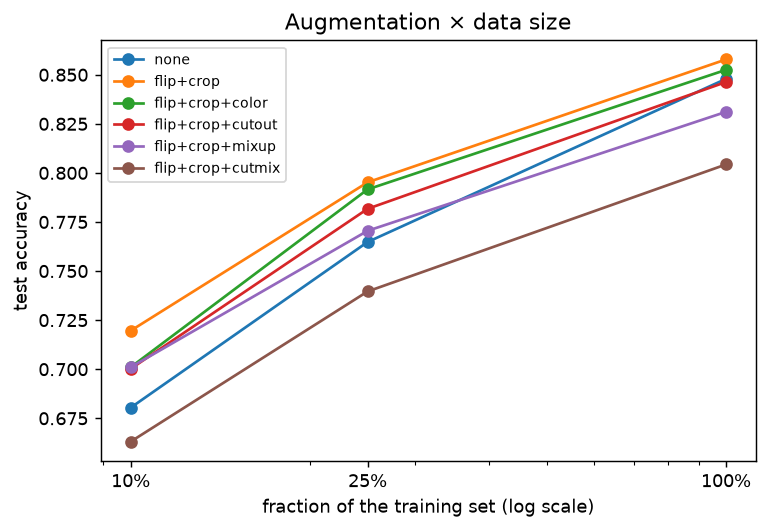
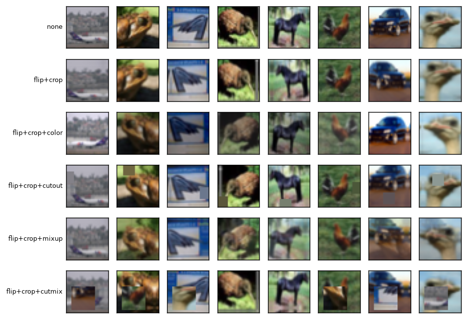

# C3 — Data augmentation × data size

SmallCNN (width 32) on HF `uoft-cs/cifar10` (train); nested stratified fractions of the 50,000 training images; epochs per fraction {0.1: 40, 0.25: 25, 1.0: 15}; 10,000 test images. Training on: AMD EPYC 7763 64-Core Processor, 4 logical CPUs, Linux; AMD EPYC 9V45 96-Core Processor, 4 logical CPUs, Linux; AMD EPYC 9V74 80-Core Processor, 4 logical CPUs, Linux; INTEL(R) XEON(R) PLATINUM 8573C, 4 logical CPUs, Linux. Results in [`results/c3_augmentation.csv`](results/c3_augmentation.csv).

| Data | Augmentation | Test accuracy (95% CI) | Gain vs none | McNemar p vs none | Train - test accuracy | Train min |
|---|---|---|---|---|---|---|
| 10% | flip+crop | 0.7196 [0.7111, 0.7289] | +0.0392 | < 0.0001 | +0.106 | 4.9 |
| 10% | flip+crop+color | 0.7010 [0.6922, 0.7097] | +0.0206 | < 0.0001 | +0.109 | 6.5 |
| 10% | flip+crop+mixup | 0.7010 [0.6921, 0.7101] | +0.0206 | < 0.0001 | +0.072 | 4.1 |
| 10% | flip+crop+cutout | 0.7002 [0.6914, 0.7094] | +0.0198 | < 0.0001 | +0.108 | 6.5 |
| 10% | none | 0.6804 [0.6707, 0.6904] | — | — | +0.320 | 2.3 |
| 10% | flip+crop+cutmix | 0.6631 [0.6543, 0.6723] | -0.0173 | 0.0003 | +0.064 | 6.6 |
| 25% | flip+crop | 0.7952 [0.7872, 0.8029] | +0.0304 | < 0.0001 | +0.078 | 7.6 |
| 25% | flip+crop+color | 0.7916 [0.7835, 0.7997] | +0.0268 | < 0.0001 | +0.069 | 10.3 |
| 25% | flip+crop+cutout | 0.7817 [0.7732, 0.7899] | +0.0169 | < 0.0001 | +0.071 | 10.1 |
| 25% | flip+crop+mixup | 0.7705 [0.7621, 0.7788] | +0.0057 | 0.1771 | +0.050 | 6.3 |
| 25% | none | 0.7648 [0.7564, 0.7728] | — | — | +0.235 | 3.6 |
| 25% | flip+crop+cutmix | 0.7396 [0.7311, 0.7483] | -0.0252 | < 0.0001 | +0.049 | 10.3 |
| 100% | flip+crop | 0.8578 [0.8503, 0.8642] | +0.0099 | 0.0039 | +0.038 | 18.1 |
| 100% | flip+crop+color | 0.8525 [0.8449, 0.8593] | +0.0046 | 0.1921 | +0.027 | 24.7 |
| 100% | none | 0.8479 [0.8408, 0.8551] | — | — | +0.132 | 8.4 |
| 100% | flip+crop+cutout | 0.8463 [0.8392, 0.8531] | -0.0016 | 0.6666 | +0.031 | 23.9 |
| 100% | flip+crop+mixup | 0.8311 [0.8236, 0.8382] | -0.0168 | < 0.0001 | +0.032 | 15.3 |
| 100% | flip+crop+cutmix | 0.8043 [0.7965, 0.8125] | -0.0436 | < 0.0001 | +0.020 | 24.4 |

What each recipe does to the same eight training images:

