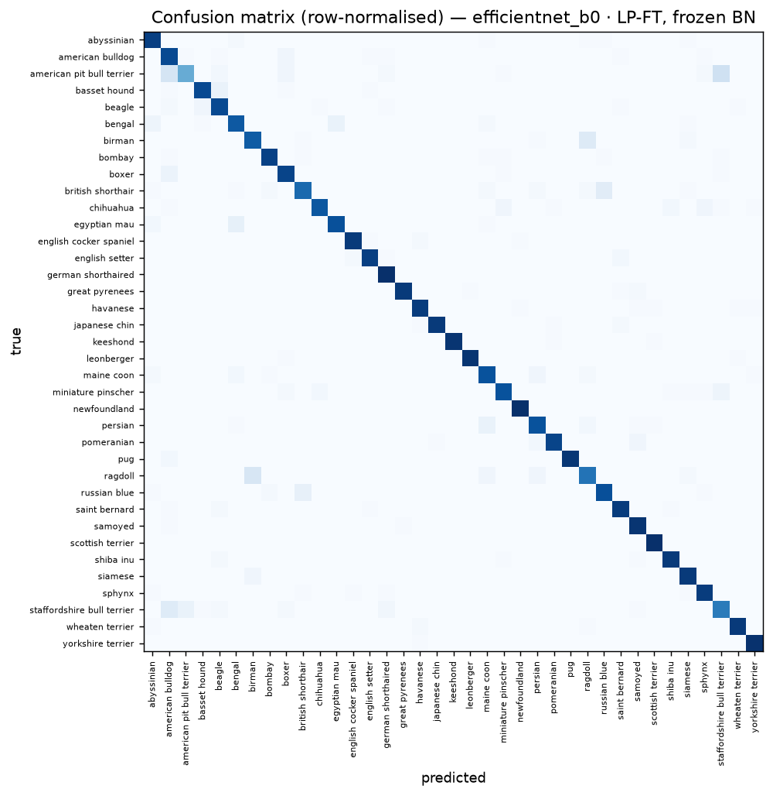
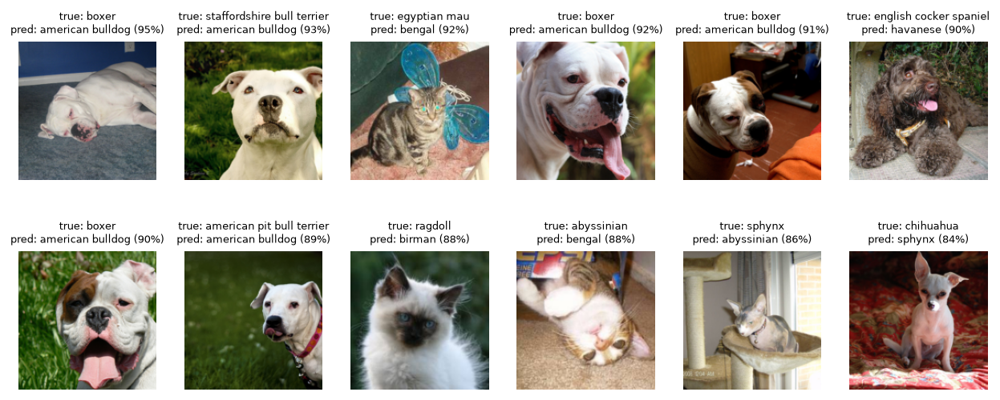
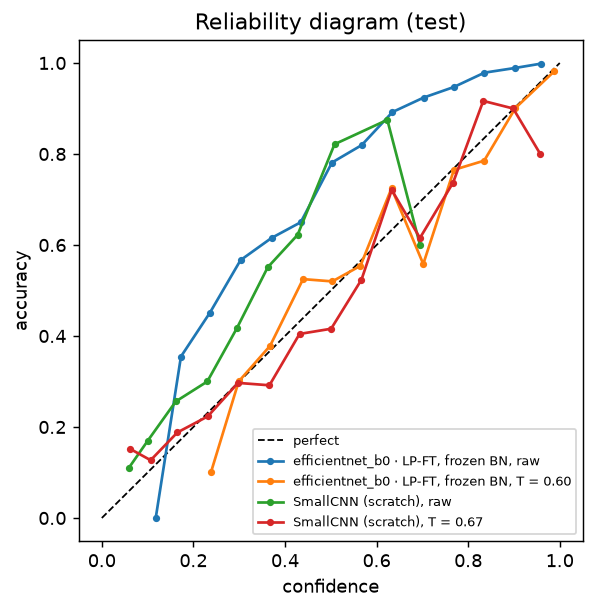
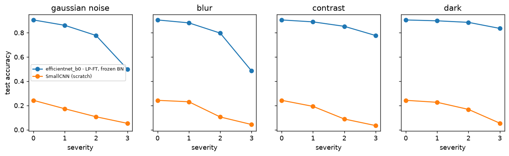
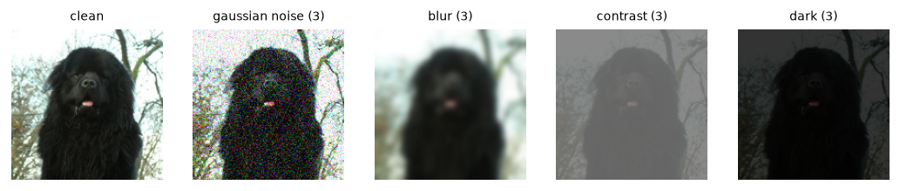

# C4 — Error analysis, calibration and robustness

Oxford-IIIT Pets test set (3,669 images, 37 breeds). Main model: **efficientnet_b0 · LP-FT, frozen BN** fine-tuned in C2, chosen by validation accuracy (mobilenetv3_small_100 · fine-tuned 73.2%, resnet18 · fine-tuned 81.3%, efficientnet_b0 · fine-tuned 84.6%, mobilenetv3_small_100 · LP-FT 78.6%, resnet18 · LP-FT 79.9%, efficientnet_b0 · LP-FT 85.6%, mobilenetv3_small_100 · LP-FT, frozen BN 83.2%, resnet18 · LP-FT, frozen BN 88.9%, efficientnet_b0 · LP-FT, frozen BN 91.6%). Results in [`results/c4_errors.csv`](results/c4_errors.csv).

## Where it goes wrong

Test accuracy 90.5%. Most-confused breed pairs (both directions):

| Breed A | Breed B | Confusions |
|---|---|---|
| birman | ragdoll | 29 |
| american pit bull terrier | staffordshire bull terrier | 26 |
| british shorthair | russian blue | 19 |
| american bulldog | american pit bull terrier | 18 |
| bengal | egyptian mau | 15 |
| maine coon | persian | 11 |
| basset hound | beagle | 11 |
| american bulldog | staffordshire bull terrier | 11 |

| Hardest breeds (F1) | Easiest breeds (F1) |
|---|---|
| american pit bull terrier 0.65 | newfoundland 0.99 |
| staffordshire bull terrier 0.70 | keeshond 0.99 |
| ragdoll 0.76 | scottish terrier 0.99 |
| american bulldog 0.77 | leonberger 0.98 |
| birman 0.82 | pug 0.98 |

The 12 most confident mistakes:

## Calibration

Expected calibration error (ECE, 15 bins) and negative log-likelihood before → after temperature scaling; the temperature is fitted on the validation split, so test accuracy is unchanged.

| Model | Temperature | ECE | NLL | Accuracy |
|---|---|---|---|---|
| efficientnet_b0 · LP-FT, frozen BN | 0.60 | 0.150 → 0.015 | 0.452 → 0.313 | 0.905 |
| SmallCNN (scratch) | 0.67 | 0.086 → 0.025 | 2.721 → 2.658 | 0.243 |

## Robustness to corruptions

Test accuracy under synthetic corruptions (severity 1–3), clean accuracy at severity 0. Mean share of clean accuracy kept at severity 3: efficientnet_b0 · LP-FT, frozen BN 72%, SmallCNN (scratch) 19%.

| Model | Clean | gaussian noise (3) | blur (3) | contrast (3) | dark (3) |
|---|---|---|---|---|---|
| efficientnet_b0 · LP-FT, frozen BN | 0.905 | 0.499 | 0.485 | 0.777 | 0.836 |
| SmallCNN (scratch) | 0.243 | 0.053 | 0.043 | 0.034 | 0.054 |

