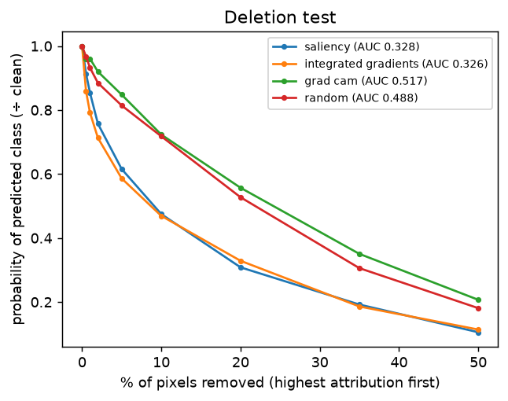
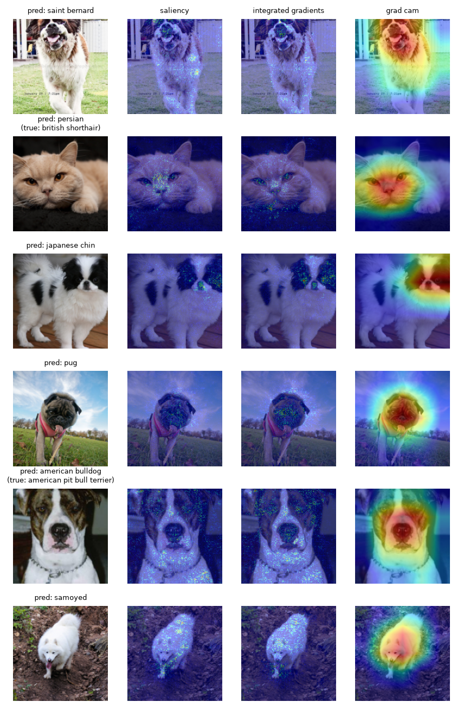
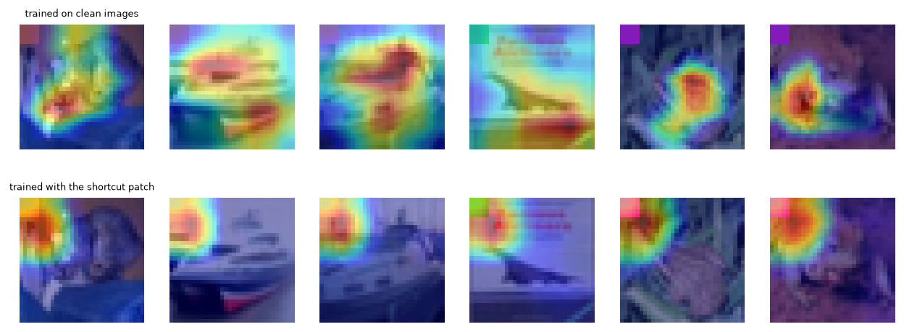

# C5 — Interpretability: attribution maps, their faithfulness, and shortcut learning

Saliency, Integrated Gradients (32 steps, mean-colour baseline) and Grad-CAM are implemented in [`interpret.py`](../src/lab_c/interpret.py). Results in [`results/c5_interpret.csv`](results/c5_interpret.csv).

## Attribution maps — efficientnet_b0 (lpft_bn) on Pets

100 random test images; each map explains the model's own prediction. Deletion AUC = mean probability of the predicted class, relative to the clean image, while the top 0–50% of pixels in the map's order are replaced by the mean colour (1 = no effect; lower = the map found pixels the model relies on). Wilcoxon vs. random order, Holm-adjusted.

| Method | Deletion AUC (mean) | Holm p vs random |
|---|---|---|
| integrated gradients | 0.326 | < 0.0001 |
| saliency | 0.328 | < 0.0001 |
| random | 0.488 | — |
| grad cam | 0.517 | 0.3305 |

## Shortcut learning

HF `uoft-cs/cifar10` (train): in the shortcut training set 95% of images carry a 5×5 patch in the top-left corner whose colour encodes the class. Both CNNs are otherwise identical (8 epochs).

| Model | Accuracy, clean | Accuracy, patch = true class | Accuracy, patch = wrong class | Predicts the patch's (wrong) class | Grad-CAM mass in the patch (area 2.4%) |
|---|---|---|---|---|---|
| trained on clean images | 0.853 | 0.847 | 0.848 | 1.6% | 0.7% |
| trained with the shortcut patch | 0.647 | 1.000 | 0.037 | 95.6% | 10.5% |

Grad-CAM on test images whose patch names the wrong class (top: clean model, bottom: shortcut model):

